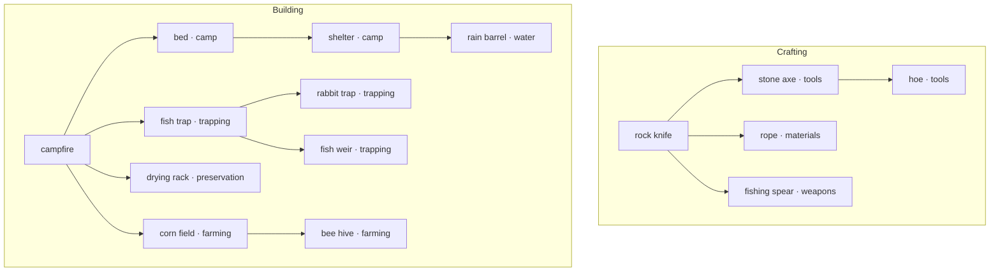

# Crafting and building trees

Status: **implemented design**. Durable gameplay rules are recorded in
[ARCHITECTURE.md](../ARCHITECTURE.md#crafting-and-building-trees--implemented).
This document explains the shared model and its implementation constraints.
The supported format is defined by `src/content/schema.ts`.

## 1. Confirmed behavior

- The centre panel has `area`, `crafting`, and `building` tabs. The map, journal, and status
  remain visible. Changing tabs takes no game time and does not pause work.
- Crafting and building each show their complete tree, including locked and completed nodes.
  Category branches group related creations; prerequisite connections determine progression.
- Clicking an eligible node starts creation directly. Its progress uses the existing work
  pipeline and progress-bar timing. Hints explain prerequisites, materials, tools, and sites.
- The crafting tree creates inventory items. The building tree constructs buildings in the
  current area. Using items and operating buildings belongs outside these creation trees;
  local lighting, planting, collection, and other building actions remain in the area tab.
- A node unlocks after **all** its prerequisite nodes have been personally completed.
  Starting work is insufficient. Finding, receiving, or owning an equivalent item is insufficient.
  A shipwreck knife does not replace personally crafting the rock knife for progression.
- Unlocks are permanent and global. Current materials, tools, and local site requirements
  still determine whether another creation can start. Losing a sharp tool does not relock
  the spear, but prevents making it until another suitable tool is obtained.
- Resuming paused creation also requires the necessary tools. Missing tools leave progress
  and reserved materials intact until the player obtains a suitable replacement.
- Finding an exact non-repeatable item does not prevent its first personal craft. The player
  spends the normal materials and time to complete that node, but ends with just one copy
  of that item in inventory, not an additional copy.
- The trees have independent progression graphs. A shared implementation serves both.
- Quests remain goals and do not unlock creation nodes. Discovering the river can start a
  fish-trap goal even while that node is locked. Discovering a suitable local fishing site
  is also a construction requirement: the beach shallows and the river qualify separately.
- Buildings use site capabilities, not lists of permitted region IDs.
- A fresh game is acceptable for this redesign. Pre-redesign progress need not be migrated.

The confirmed initial edges are content, not engine rules:



Building the campfire completes its node; lighting it is unnecessary. These initial links
and the mushroom-content removal are confirmed. All categories and edges remain editable
content, so future progression changes do not require changes to the engine or renderer.

## 2. One graph model, two kinds of target

Add `content/trees/*.json`, with exactly one definition of each kind (`craft`, `build`).
Each node references an existing recipe or building rather than duplicating its costs,
duration, output, text, or production rules. A crafting node represents a **recipe**, not
an inventory item; its output item remains `Recipe.item`.

Illustrative subset, not a complete content file:

```json
{
  "id": "crafting_tree",
  "kind": "craft",
  "name": "crafting",
  "branches": [
    { "id": "craft_tools", "name": "tools", "order": 0 },
    { "id": "craft_materials", "name": "materials", "order": 1 }
  ],
  "nodes": [
    { "target": "craft_rock_knife", "branch": "craft_tools", "after": [], "order": 0 },
    { "target": "craft_axe", "branch": "craft_tools", "after": ["craft_rock_knife"], "order": 0 },
    { "target": "craft_rope", "branch": "craft_materials", "after": ["craft_rock_knife"], "order": 0 }
  ]
}
```

- `kind` determines the target type for every node. `target` is the node's stable identity
  within that tree; no parallel technology ID is needed for the same creation.
- `after` is an explicit array, including `[]` for roots, and always means **all** predecessors.
  References must resolve within the same tree. Do not derive dependencies from item costs.
- `branch` is a presentation category, independent of dependencies. Connections can cross
  branches, as the rock knife unlocks both an axe and rope. Category IDs do not need to match
  the existing inventory category enum; weapons can be a branch without changing item storage.
- The graph is directed and acyclic; a node can have multiple parents. It is called a tree
  in the UI, but implementation must not assume a single parent.
- Derive depth as `0` for roots and `1 + max(parent depths)` otherwise. Use branch order,
  node order, and target ID as stable layout tie-breakers. Authors do not maintain a second
  depth field or hand-written coordinates.
- Roots, branches, and edges are data. Adding an ordinary recipe, building, branch, or area
  must not require an engine switch statement or renderer special case.

The registry constructs target indexes, parent/child indexes, and topological order once.
Do not rebuild the graph on every simulation step or add a graph framework dependency.

## 3. Progression and current availability

Use explicit saved progression, separate from inventory, local building counts, quests,
`seen`, and general `did` counters:

```ts
technology: {
  craft: { completed: string[]; unlocked: string[] };
  build: { completed: string[]; unlocked: string[] };
}
```

These are unique ID sets serialized as arrays. Keeping both sets is intentional: `completed`
means personally made, while `unlocked` records permanent permission. Deriving permission
only from today's graph could relock an already unlocked node after an author edits its parents.

At new-game creation, unlock all roots and complete nothing. On successful creation completion:

1. Remove the pending work record, as today, so completion cannot be delivered twice.
2. Deliver the item or local building and apply the existing completion effects. For a
   non-repeatable recipe, ensure one copy of its output item rather than adding a duplicate.
3. Record the exact recipe/building node as completed, idempotently.
4. Add nodes whose entire `after` set is completed to `unlocked`; never remove existing unlocks.
5. Evaluate quests and completion notices against the resulting state, then save that state.

Unlocking a node does not complete it and cannot cascade through uncrafted descendants.
Only actual craft work or building work with `step: "build"` records completion. A `give`,
quest reward, event-created building, debug grant, lighting action, or production collection
does not. Do not attach progression recording to generic `give()` or `addBuilding()` helpers.

Current availability is derived, not saved:

```text
canStart = unlocked
        AND valid selected creation method
        AND current requirements satisfied
        AND sufficient unreserved materials
        AND quantity/instance limit permits another creation
        AND existing work and interaction rules permit starting
```

Completed nodes stay visible. Repeatable recipes and buildings below their local `max` remain
actionable. Repeatable recipes retain their output `count` and item-capacity rules; buildings
retain local `max` semantics. For non-repeatable recipes, the possession check permits work
when the node has never been personally completed **or** its output item is no longer owned.
The exception bypasses only the possession/capacity blocker for that first personal craft;
it does not bypass prerequisites, tools, materials, or time.

On completion of a non-repeatable recipe, ensure exactly one copy of the output item in
inventory. Resolve this against inventory at completion, so finding the item during paused
work cannot produce a duplicate and losing a found copy during work still leaves one crafted
copy. An unchanged inventory count still records personal completion and unlocks descendants.
Once completed and owned, that node is unavailable for another craft. A lost non-repeatable
tool can be crafted again; recreating it does not erase or repeat its first-completion
progression event. This rule applies to the exact output item, not other tools sharing its tags.

For later content edits, reconcile known IDs at the loading boundary, preserve surviving
completed/unlocked entries, and add newly eligible nodes. A supported node rename needs an
explicit migration; display-label changes do not. Do not infer missing completion history
from possessions. Invalid progression shapes must not silently become an empty history.

## 4. Local site capabilities

Declare capability IDs and player-facing labels/requirement text in `content/sites.json`.
For example, `fishable_water` means a suitable fishing site, not merely any water source.
Use a region's optional `siteCapabilities: Id[]` for capabilities available without exploring,
and the same field on landmarks for capabilities granted by discovering that landmark.

Illustrative additions to existing landmark definitions:

```json
{ "id": "school_of_fish", "siteCapabilities": ["fishable_water"] }
{ "id": "river", "siteCapabilities": ["fishable_water"] }
{ "id": "field_site", "siteCapabilities": ["cultivable_ground"] }
```

These are partial examples; existing landmark labels, time, text, and effects remain required.
The current area's effective capabilities are its base capabilities plus those on its
**locally discovered** landmarks. Derive this union from existing discovery state; do not
copy it into a global flag or store another mutable capability list in saves.

Extend the shared condition vocabulary with `{ "site": "fishable_water" }`, always evaluated
in the context's area. Building `build.requires` uses this condition along with existing tools
and other requirements. A field requires `cultivable_ground`; the beach supplies none.
Registry checks and `conditions.ts` explanation support must accompany this new condition.

Replace building `places` with these capability conditions. Preserve existing non-location
requirements, such as a bed needing shelter, through existing conditions. Avoid two competing
location filters. The exact capability assignment for each current building must be reviewed
when converting content, rather than inventing terrain restrictions in code.

This design retains building instances at `building@region`. Capability grants establish
eligibility within an area; they do not add site selection, construction slots, capacity,
or buildings attached to individual landmarks. Those would require a separate design.

## 5. Creation rules and commands

Introduce direct `{ type: "craft", recipe: Id }` and `{ type: "build", building: Id }` commands.
Keep the existing `building` command for local production `start` and `collect`. Public
commands resolve definitions safely, check the same eligibility used by the view, and then
enter existing `startWork`/`stepActions`/completion paths. Direct commands cannot bypass a lock,
missing tool, undiscovered site, insufficient materials, or local building limit.

Remove craft/build `menu` commands and their popup kind after all callers move. Exploration,
story events, and completion notes keep their popups and existing blocking semantics. Update
command event keys and completion snapshots so direct commands do not double-fire events or
lose the existing completion notes.

Remove creation `availableWhen` visibility gates. Move retained non-quest requirements into
an explicit common `Recipe.requires` or existing `Building.build.requires`; combine recipe
requirements with the selected way's requirements for checking and tool-adjusted duration.
Remove quest-status gates instead of moving them into these fields. All tree nodes stay visible.
Specifically remove the rock knife's `not sharp` gate: it must be craftable even with the
shipwreck knife. Review discovery restrictions separately from progression restrictions.

Retain recipe `ways` and their existing automatic first-eligible selection. They describe
methods and narrative, not tree nodes. When no method is eligible, the node stays visible and
its hints describe available methods and what is missing; do not quote an inapplicable
method's duration as an executable promise.

Extend shared rule evaluation to produce structured requirement entries, not just the first
error string: required/available materials, tool capabilities, local sites, other conditions,
predecessor completion, limits, and selected duration. Preserve `all`/`any`/`not` meaning in
explanations. Return enough information for both node hints and command refusal without
implementing a second rule engine in the renderer.

Resolve and reserve costs once at start. Preserve the chosen method, required work, location,
and existing reserved inputs during pause/reload. Tab changes never execute engine commands.
At creation start, capture a tool predicate from the selected recipe method/common requirements
or building definition: retain tool leaves and boolean operators, and freeze other leaves to
their current boolean values. Save that predicate with the work. Before resuming paused creation,
evaluate it against current tool capabilities. This preserves mixed `all`/`any`/`not` semantics
without reevaluating consumed materials or switching the saved method. A replacement satisfying the capability
is sufficient; do not require the original physical item. Missing tools keep the work paused
and supply the same explanation to the work summary and command refusal. Use this check on
every resume entry point, including a node resuming existing work and explicit resume commands.
Do not rerun the new-work possession or material-cost checks against already committed work,
charge reserved materials again, switch recipe methods, or reset progress/duration on resume.

## 6. UI and progress

Use one tree view model and renderer, parameterized by tree kind. Node views include stable
target ID, branch, depth, predecessor IDs, unlocked/completed flags, eligibility, structured
hints, counts/limits, creation command, and matching active/paused work. Completion and
eligibility are independent flags: a completed rope node can still be ready to craft again.
For a first personal craft whose output is already owned, the hint states that crafting
completes the node while inventory remains at one copy; normal materials and duration are shown.
Completion feedback must acknowledge the node completion even when no inventory count increased.

The shared renderer uses ordinary HTML controls with category columns and depth rows;
SVG connections can show dependencies without making nodes inaccessible. Keep native keyboard
activation and labelled tab panels. Disabled nodes must remain inspectable by keyboard and
touch; use a guarded `aria-disabled` control and an accessible hint/details affordance.
The creation control starts work directly; an optional details control does not open a
craft/build modal or start work accidentally. Provide textual prerequisite lists in addition
to connectors and color. On phones, allow the tree panel to scroll without widening the page.

Keep node elements keyed across updates to preserve focus and progress interpolation. Change
work presentation targets from shared `menu:craft`/`menu:build` controls to the specific recipe
or building node. Include the work location when matching building progress: work paused in
another area must not look like construction at the current site. Keep the persisted work ID
as job identity, distinct from a UI target.

The centre tab selection is transient presentation state. It does not belong in `GameState`.
Keep a shared work summary outside the switchable panels, so pause/resume and progress remain
accessible from every tab. Navigation remains usable during work; the existing restriction
on initiating additional player work in the UI remains. Opening a real blocking popup still
pauses scheduling. Hidden panels do not own timers, complete work, or duplicate commands.

## 7. Module responsibilities

| Module | Change |
|---|---|
| `content/schema.ts`, `registry.ts` | Tree/site schemas, references, graph indexes, authoring validation. |
| New `core/technology.ts` | Permanent completion/unlock updates and shared graph eligibility. |
| `core/conditions.ts` and a small site helper if needed | Local capability evaluation and explanations. |
| `core/action-rules.ts` | Shared structured requirements, costs, tool factors, duration. |
| `core/engine.ts` | Direct commands, completion integration, existing work orchestration. |
| `core/state-schema.ts`, `state.ts`, `persistence/` | Progression state, initialization, version boundary. |
| `core/selectors.ts` | Both tree views from the same rules; existing area operations. |
| `core/work.ts` | Node-specific presentation targets; retain persisted work semantics. |
| `ui/layouts/`, shared tree renderer, `ui/render.ts` | Tabs, layout, node controls, hints, progress. |
| `app/action-controller.ts` | Retain scheduling; navigation is not a scheduled action. |

This is not a new research subsystem, universal job scheduler, or replacement production
engine. Recipe outputs and local building operations keep their existing definitions.

## 8. Authoring validation and tests

Registry errors must identify file and field. Reject duplicate tree kinds/IDs/targets, missing
recipes/buildings/categories/capabilities, duplicate parents, self-dependencies, cross-tree
references, and cycles (report the cycle path). Every recipe and building needs exactly one
node in the matching tree. New tree/category/capability IDs follow existing global identity
rules; target references reuse existing entity IDs without claiming new identities.

Reject quest conditions anywhere in creation eligibility, including nested conditions and
method visibility. Validate site references and require each required capability to have a
provider somewhere in content. Keep existing cost, effect, tool, time-step, and sentence checks.
Non-repeatable recipes must output one item (`count` omitted or `1`); larger output batches
belong to repeatable recipes, avoiding a contradiction with the single-copy completion rule.
Static graph validation cannot prove that survival, resource chains, and discoveries are
playable; representative playthroughs are also required.

Required behavior coverage for implementation:

- Root initialization; all-parent unlocks; no unlock from starting/pausing work or from merely
  unlocking a parent; exact personal completion versus finding/grants/equivalent tools.
- Permanent unlocks after spending/losing items, moving areas, reload, and supported edge edits;
  tree independence and recreation without duplicated progression.
- Missing tools/materials block an unlocked node; preview and direct commands agree; costs are
  reserved once and completion is delivered once, including interruption and reload.
- Losing a tool during paused creation prevents every resume path; a qualifying replacement
  permits resumption without changing the saved method/duration, losing progress, or charging
  inputs again. Include saving/reloading the paused work before obtaining the replacement.
- An exact found non-repeatable item permits the first personal craft at normal cost/time;
  completion leaves one copy and unlocks descendants even with no inventory-count increase.
  Cover finding or losing that item during paused work, subsequent duplicate-craft refusal,
  recreation after loss, and unchanged repeatable output quantities.
- The beach shallows and river grant fishing eligibility only in their own discovered areas;
  a field cannot be built on the beach; global progression does not provide global sites.
- Quests still start and finish, including goals encountered after their building was already
  constructed; quests neither gate nor bypass tree prerequisites. Confirm each quest's intended
  local/global completion condition during content conversion.
- Completed repeatable nodes remain usable; instance limits remain local; building production,
  collections, timers, sleep, and travel retain their existing behavior.
- Tab navigation during work, progress on the correct node, no duplicate starts, blocking notes,
  accessible hints, and desktop/phone rendering.
- New saves preserve reservations, chosen methods, progression, and local production; old saves
  receive the explicit incompatibility result rather than an accidental migration.

## 9. Save boundary and delivery sequence

Save version 7 is the compatibility boundary for this redesign. Check both the save envelope and inner state at the loading boundary.
Return a specific fresh-game-required result for pre-redesign saves; do not convert historical
inventory/counters into personal completions or feed old menu popups into the new runtime.
Keep old data intact until the player uses the existing new-game/recovery flow. Autosave and
manual/pre-sleep slots remain separate, and both must respect the compatibility boundary.

Suggested implementation sequence:

1. Finalize the full edge/category/site table using the confirmed rules.
2. Add schemas, registry indexes, validation, progression state, and the save boundary.
3. Add shared requirements/site evaluation and direct creation commands with behavior tests.
4. Convert content and quest relationships; verify resource and discovery routes from a new game.
5. Add tabs and the shared tree renderer, then remove obsolete craft/build popup code and labels.
6. Update unit helpers, simulation consumers, e2e selectors/content checks, authoring instructions,
   and playable documentation. Run `npm run check` and inspect desktop and phone layouts.

The resource audit also removed the indirect quest gate from `strip_bark`: discovered forest
access and a sharp tool provide bark for rope independently of quest status. Keep resource
chains reachable when editing prerequisites; unrelated quest conditions remain separate.

The initial `bed → shelter` edge also interacts with the current bed's shelter requirement.
The beach's discovered natural rock shelter provides the starting route; ensure the full
new-game playthrough can obtain the materials and build that first bed before unlocking a
constructed shelter. Do not silently reverse the agreed edge or remove the shelter rule.

## 10. Initial content configuration

The behavior and initial dependency questions are resolved, including required tools on resume
and first personal crafts of already-owned non-repeatable items. The diagram above records
the confirmed initial links. `content/trees/crafting.json` and `content/trees/building.json`
define their category assignments and edges; `content/sites.json` and region/landmark
`siteCapabilities` define local construction eligibility. These validated files are the
authoritative configuration for extending or rebalancing the trees.
