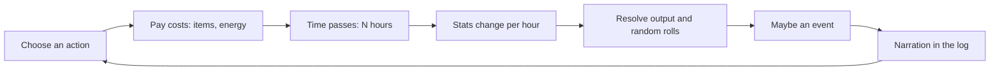
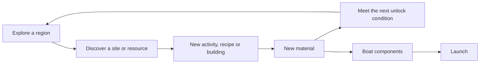
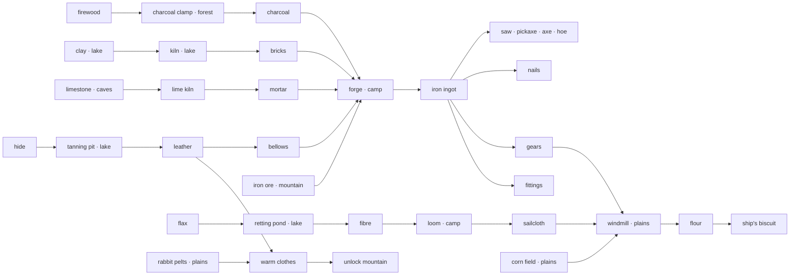

# Text Island: Game Design Document

Version 0.1 (draft for review) · Owner: František Dvořáček · Last updated: 2026-10-19

Status markers used in this document:

- **[decided]**: confirmed by you in the design Q&A.
- **[proposal]**: my design, open for review.
- **[open]**: needs a decision before the related milestone.

This document includes the longer-term island, technology and voyage design. The current
prototype implements the beach, forest and meadows, survival, tasks, crafting/building and
local production. Sections marked as future or proposal are not current gameplay; `README.md`
describes the playable scope and `docs/TDD.md` describes implemented architecture.

---

## 1. Pitch

A minimalist text survival game in the style of *A Dark Room*. You wake up alone on a beach after a shipwreck. Survive, explore the island region by region, and work your way from bare hands to a forge, a windmill and a shipyard. The game ends when you launch a seaworthy sailing boat and leave.

The screen is a few buttons, a scrolling story log, and a status panel. Occasional hand-drawn ink illustrations mark the big moments.

| Fact | Value |
|---|---|
| Genre | Text survival / crafting / exploration |
| Player | One castaway, alone for the whole game **[decided]** |
| Session | 2–4 hours for one full playthrough **[decided]** |
| Platform | Desktop browser **[decided]** |
| Inspirations | *A Dark Room* (form, pacing, voice), Jules Verne's *The Mysterious Island* (progression from nothing to industry) |
| Title | Mysteryless Island **[decided]**: a nod to Verne; the player is never sure whether the island hides a mystery |

---

## 2. Design pillars

1. **Every hour counts.** Each action trades in-game time and energy for progress. Hunger, thirst and temperature keep moving while you work. The core decision is always "what is this hour worth?"
2. **The island reveals itself.** The interface starts with almost nothing. New buttons, new tabs (regions) and new status lines appear as you learn and explore. Discovering what the game contains is part of the reward.
3. **From hands to iron.** Each technology is a believable step from the previous one (stone → fire → clay → charcoal → iron → machines → ship). The player should feel clever, like Verne's engineer.
4. **A quiet voice.** Short sentences, no explanations. Mechanics carry the story.

### Non-goals

- No combat screen. Dangers are resolved through events with choices **[decided]**.
- No villagers or workers. Automation comes only from buildings that run processes over time **[decided]**.
- No item spoilage, tool durability or building upkeep **[decided]**.
- No procedural island map. Regions are hand-authored; variety comes from events and weather **[decided]**.
- No multiplayer or monetisation.

---

## 3. Player experience arc

How the 2–4 hours should feel. Times are targets for the balance simulator (see TDD §13).

| Real time | In-game days | Phase | What the player feels | Key beats |
|---|---|---|---|---|
| 0–10 min | 1–2 | **Washed up** | Disoriented, urgent | Thirst, coconuts, searching the wreck, first fire, first night |
| 10–40 min | 3–12 | **Getting a grip** | Relief, small mastery | Shelter, stone tools, the forest opens, first hunt |
| 40–90 min | 13–30 | **Spreading out** | Curiosity, planning | Lake (clay, fresh water), plains (snares, corn, flax), first processes left running |
| 90–150 min | 31–55 | **Iron age** | Triumph | Warm clothes, the mountain, iron ore, the forge is lit, iron tools |
| 150–210 min | 56–80 | **The shipwright** | Purpose, anticipation | Windmill, sailcloth, pitch, the hull takes shape stage by stage |
| final 10 min | — | **The voyage** | Release | Launch, voyage event, ending |

Every phase ends with a visible change in the UI: a new tab, a new building section, or a new illustration.

---

## 4. Core loops

### 4.1 Action loop (seconds)



Each button shows its cost on hover: duration, energy, consumed items, and possible outputs once known.

### 4.2 Day loop (minutes)

Morning: check status, plan. Day: work in regions (gather, craft, build, explore), eat and drink as needed. Evening: return to camp before it gets cold or dark. Night: sleep until the next 6am. Sleep restores energy, advances local production, pauses unfinished player work, and writes the manual saved game just before sleep. Autosaves separately preserve ongoing progress.

### 4.3 Progression loop (the whole game)



### 4.4 Why the loops work together

- **Survival stats** keep the action loop from being free. Gathering 10 logs costs hunger and thirst, so food and water production is always part of the plan.
- **Processes** (charcoal burning, kiln firing, crops growing) run in in-game time. Starting one before a long trip or before sleep is the main efficiency skill. This replaces *A Dark Room*'s idle village for a solo player.
- **Region climate** links survival to progression. The mountain is cold, so warm clothes are a prerequisite for iron. The plains have no water, so water containers are a prerequisite for farming.
- **Seasons** add planning. Crops grow only in spring and summer; winter makes the mountain more dangerous.

---

## 5. Time model **[decided: action-based clock]**

- The in-game clock advances while a chosen action runs. Reading or thinking without active work advances no time; an open pop-up pauses active work. Nothing advances while the game is closed.
- Time unit: minutes internally. Actions take 30 min to 8 h.
- A day has four phases: **dawn** 05:00–07:00, **day** 07:00–18:00, **dusk** 18:00–20:00, **night** 20:00–05:00 **[proposal]**.
- Some actions are restricted at night (no exploring without a torch; hunting has worse odds).
- The game starts at dawn on day 1, early spring **[proposal]**.

**Seasons [proposal]:** 4 seasons × 20 days = an 80-day year, which matches the 2–4 hour target. Season length is a data value.

| Season | Days | Effect |
|---|---|---|
| Spring | 1–20 | Mild. Planting allowed. Rain common. |
| Summer | 21–40 | Hot days (thirst ×1.3 on plains and beach). Grass fires possible. |
| Autumn | 41–60 | Harvest. Storms more common (wreckage washes up). |
| Winter | 61–80 | Cold nights everywhere. No planting. Mountain blizzards. Bad season to sail. |

**Paced work [implemented]:** actions advance the live game in 15-minute steps at 10 real
seconds per game hour (2.5 seconds per step). Bars show saved work progress. Outputs arrive
when work completes. Sleep jumps immediately to 6am. Travel and sleep pause work that needs
the player's presence; inputs stay reserved, and reload restores progress. The core supports
equal focus sharing between concurrent actions; the current UI offers one active action.
Multitasking controls and perks remain future work.

---

## 6. Survival model

### 6.1 Stats **[decided: energy drives daily work; health is the life bar]**

All stats are numbers from 0 to 100 internally. The status panel shows each one as a thin **ink bar**, the same line as the button cooldown bars, where **fuller is always better** (hunger is drawn as *fullness*, thirst as *hydration*, warmth as *comfort*: freezing 20%, cold 60%, comfortable 100%). A bar at or below 20% turns red, which warns that supplies or energy are low. **Only an empty health bar ends the game**; hunger and thirst change energy costs, and zero energy causes collapse. Hovering a row shows the word below and the trend. *(Prototype iterations: words → stars → ink bars, at your request; stars read as a review score.)*

| Stat | Meaning | Words (low → high value) | Changes by |
|---|---|---|---|
| Health | Life. At 0 the player dies. | dying · badly hurt · hurt · bruised · healthy | Cold and other health hazards; slow regeneration |
| Energy | Ability to work | exhausted · weary · tired · rested | −per hour of work; + sleep, food, and drinks |
| Hunger | 0 = full, 100 = starving | fed · peckish · hungry · starving | + per hour; − eating |
| Thirst | 0 = quenched, 100 = parched | quenched · dry · thirsty · parched | + per hour (more when hot); − drinking |
| Comfort | Body temperature state | freezing · cold · comfortable | Moves toward the environment (§6.2) |

**Initial rates [proposal; all values live in data]:**

| Rule | Value |
|---|---|
| Effort levels | Every action is *heavy* (felling, hunting), *work* (gathering, exploring), *light* (crafting, eating) or *rest*. The rates below are for *work*; heavy and light scale up and down (TDD §6.11). |
| Hunger | +3 / h working, +1.5 / h asleep |
| Thirst | +5 / h working, +2 / h asleep |
| Energy | −8 / h heavy, −5 / h work, −2 / h light. Costs ×1.5 when hungry or thirsty (41+); ×0.5 when both fed and hydrated (20 or below). Food and drinks restore energy. |
| Health loss | −3 / h while *freezing*. Hunger, thirst, and exhaustion never damage health. |
| Health regeneration | +1 / h when fed, quenched and comfortable; +3 / h while sleeping in a shelter under the same conditions |

With these rates a player with no water goes from *quenched* to *parched* in about 20 hours. That's urgent but survivable.

**Readability rule:** each word band must give at least 6 in-game hours of warning before damage starts. The status tooltip shows the trend ("getting thirstier"), never the number.

### 6.2 Temperature **[decided: region + day/night + weather/seasons + clothing/shelter]**

Authors write temperatures in °C because that's intuitive. The engine computes:

```
environment °C = region base
               + day-phase modifier      (night −6, dawn −3, day +0, dusk −2)
               + season modifier         (spring 0, summer +5, autumn −2, winter −8)
               + weather modifier        (rain −3, storm −6, heat wave +6 ...)
               + local heat              (fire pit at camp +8, shelter +4 ...)

felt °C        = environment °C + clothing insulation
```

| Felt °C | Body state target |
|---|---|
| < 5 | freezing |
| 5–14 | cold |
| ≥ 15 | comfortable |

**[decided]** Comfort has three values; there are no heat bands. Being too warm isn't a danger in this game. If summer heat should matter later, *hot* and *overheating* can be added back as data in `climate.json`, with a thirst multiplier in `stats.json`.

Body warmth moves **one band per hour** toward the target (like the room temperature in *A Dark Room*). That gives the player time to react.

Region bases **[proposal]:** beach 24, forest 20, lake 18, plains 25, caves 13 (no day/night swing), mountain 6, summit −2.

### 6.3 Food and water

- Raw fish and meat must be cooked or dried. Other edible foods and drinking water are consumed automatically at 60 hunger/thirst; manual consumption remains available. Eating and drinking also restore energy.
- Water sources: coconuts (early, limited), rain catcher (passive while raining), lake (unlimited; fever chance unless boiled in a clay pot), snow on the mountain.
- Water is an item in the global stockpile ("fresh water" units). The player needs containers (coconut shells, clay jars, later barrels) to store it. **Containers act as the storage cap for water only** **[proposal]**. That keeps water a constant concern without carry logistics.

### 6.3b Daily sleep [implemented]

Voluntary sleep requires a bed built in the current area; the sleep button is hidden otherwise. Sleep always ends at 6am at the same place. A sheltered bed with a local fire burning at bedtime sets morning energy to 100% before midnight. Without fire, or from midnight onwards, a sheltered bed gives 80%. An exposed bed or no bed gives 50%. Discovered beach rocks count as natural shelter for the first bed, once campfire construction unlocks its node; elsewhere, build a shelter first. Campfires are built separately (2 stones), then lit and fueled in their own area. Recovery uses conditions at bedtime, even if the fire expires overnight. After the first night, the “better sleep” task asks for a bed and lit fire in the same sheltered area. At midnight or zero energy the player collapses where they are and sleeps until 6am; unfinished player work pauses and its materials stay reserved. The morning journal announces the day and describes sleep quality. Production continues overnight.

### 6.4 Death and saves [implemented]

- Zero health ends the run permanently and opens the end screen.
- The player may load the manual saved game or start again. Choosing *save.* and going to
  sleep write that slot; autosaves separately preserve every completed action and work step.
- Gameplay and narrative RNG states are saved independently. Reloading repeats the same
  gameplay rolls for the same choices; text variants cannot change those rolls.

---

## 7. The island

### 7.1 Regions **[proposal: full set; you named beach, forest, plains, mountains, lake]**

Seven regions; six are required for the boat. One optional region holds the mystery payoff.

| # | Region | Base °C | How it unlocks | Main role |
|---|---|---|---|---|
| 1 | **The Beach** (camp) | 24 | Start | Camp, wreck salvage, crafting hub, shipyard |
| 2 | **The Forest** | 20 | Explore the beach until you find *a trail into the trees* | Wood, fibre, hunting, charcoal, pitch, planks |
| 3 | **The Lake** | 18 | Explore the forest: *the sound of running water* | Fresh water, fish, clay, reeds, kiln, tanning |
| 4 | **The Plains** | 25 | Explore the lake: *the trees thin out*, **and** own a water container | Rabbits (pelts), corn, flax, windmill |
| 5 | **The Caves** | 13 | Explore the plains: *dark openings in the hillside*, **and** carry a torch | Stone, flint, limestone, the mystery |
| 6 | **The Mountain** | 6 | Explore the caves: *a pass above the tree line*, **and** wear warm clothes | Iron ore, goats, snow |
| 7 | **The Summit** (optional) | −2 | Explore the mountain **and** own a rope | Mystery payoff, best view of the sea, voyage bonus |

**Travel [proposal]:** each region has a travel time from camp (forest 1 h, lake 2 h, plains 2 h, caves 3 h, mountain 4 h, summit 6 h). Switching to a region tab means walking there and costs that time. A *path* upgrade per region halves travel time. This makes distance meaningful even with a global stockpile, and gives a visible reward for progress.

Candid trade-off: tab switching that costs time may surprise players used to *A Dark Room*. The tab label shows the cost ("the forest · 1h"), and returning to camp is a separate button.

**Sleeping away from camp [proposal]:** allowed anywhere ("sleep rough"). Worse energy recovery, colder, higher chance of a night event. Building a *lean-to* in a region allows safer sleep there.

### 7.2 Region details

Each region has five parts: **activities**, **buildings**, **discoveries** (found by exploring), **events**, **illustration**.

#### The Beach (camp)
- Activities: search the wreck (finite, 6 searches with scripted finds: knife, canvas, rope, a tin cup, a handful of nails, a sealed tin of biscuits), gather driftwood, collect coconuts, dig for clams, collect seaweed, rest in the shade, explore the beach.
- Buildings: fire pit → hearth (upgrade), lean-to → hut → cabin (shelter upgrades), rain catcher, drying rack, salt pan, workbench, forge, shipyard.
- Discoveries: *a trail into the trees*, *a tidal cave with nesting birds* (eggs), *a second wreck at low water* (late, extra iron scrap).
- Events: a crate in the surf (after storms), footprints that are not yours (mystery), sea turtle nest, crab pinch, message in a bottle.

#### The Forest
- Activities: gather firewood, strip vines (fibre), forage (berries, mushrooms), collect resin, hunt (needs spear; boar or deer → meat, hide), fell trees (needs axe → logs), explore.
- Buildings: charcoal clamp (wood → charcoal over 24 h), tar kiln (resin + wood → pitch), sawpit (logs → planks; needs iron saw), lean-to.
- Discoveries: *game trail* (hunting), *a stand of tall pines* (resin, keel timber), *the sound of running water* (lake).
- Events: wild boar, snake bite, lost in the thicket, honey in a hollow tree, strange cut marks on a trunk (mystery).

#### The Lake
- Activities: drink, fill water containers, fish (spear, then line and hook), dig clay, cut reeds, collect bark, explore.
- Buildings: fish weir (passive fish per day), kiln (clay → pots, jars, bricks), tanning pit (hide + bark → leather over 48 h), retting pond (flax → fibre over 72 h).
- Discoveries: *clay banks*, *a shallow bay full of fish*, *the trees thin out* (plains).
- Events: fever from unboiled water, a heron steals fish, something large in the water, a dry spell lowers the lake.

#### The Plains
- Activities: set snares (rabbit meat, pelts), gather wild corn (food and seed), gather wild flax, plant a field (spring and summer only), harvest, explore.
- Buildings: corn field (plant → grows 10 days → harvest), flax field, windmill (corn → flour; needs iron gears and sailcloth), lean-to.
- Discoveries: *a rabbit warren* (snare yield ↑), *wild corn*, *wild flax*, *dark openings in the hillside* (caves).
- Events: grass fire (summer), a hawk takes the catch, a stampede of wild goats, a rainbow after the storm.

#### The Caves
- Activities: explore (each visit uses a torch), quarry stone, collect flint, collect limestone, explore deeper.
- Buildings: lime kiln (limestone → lime mortar for the forge and hearth).
- Discoveries: *an old camp*, *drawings on the wall*, *a pass above the tree line* (mountain).
- Events: the torch gutters, bats, cave-in, a sealed chest (mystery).
- Note: the caves stay 13 °C day and night. They are a refuge in the summer heat and the winter cold.

#### The Mountain
- Activities: collect rust-red stones (first iron ore, by hand), mine iron ore (needs pickaxe; much better yield), hunt goats (hide, horn), collect snow (water), explore.
- Buildings: mine shaft (raises the mining yield), lean-to (stone).
- Discoveries: *an iron seam*, *goat paths*, *a ledge toward the summit*.
- Events: rockslide, blizzard (winter), frostbite, an eagle's nest.

#### The Summit (optional)
- Activities: look out over the sea (reveals the voyage route → lower voyage risk), collect sulphur, explore.
- Purpose: the mystery payoff (§10) and a voyage bonus. Skipping it is allowed.

### 7.3 Adding regions later

A region is one data file (TDD §6). New regions should hook into the existing unlock chain through discoveries and conditions, without code changes.

---

## 8. Technology and crafting

### 8.1 Tiers **[proposal]**

**Creation trees [implemented]:** crafting and building have separate centre-panel
tabs with independent trees using the same system. All nodes are visible, grouped by category;
personally completing all predecessors permanently unlocks a node. Current tools/materials
and discovered local site capabilities still gate creation. Quests remain goals rather than
unlocks. This replaces the earlier proposal for implicit technology progression without its
own screen. See [the redesign](CRAFTING_BUILDING_DESIGN.md); the tiers below remain proposals.

| Tier | Theme | Key items and buildings | Gate to next tier |
|---|---|---|---|
| T0 | Bare hands | driftwood, coconut, stones, seaweed, wreck salvage (knife, canvas, rope, nails, tin cup) | fire |
| T1 | Stone and fibre | sharp stone, stone axe, spear, cordage, basket, bow drill, torch, fire pit, lean-to, rain catcher | clay + steady water |
| T2 | Fire and clay | clay pot (boil water), jar, bricks, kiln, charcoal clamp, cooked food, smoked fish, leather, rabbit-fur coat, boots → **warm clothes** | warm clothes + charcoal + bricks |
| T3 | Iron | iron ore, bloomery forge (bricks + lime mortar + leather bellows), iron ingot, iron tools (axe, pickaxe, saw, hammer, chisel, hoe), nails, fittings, gears | iron saw + gears |
| T4 | Machines and cloth | sawpit → planks, tar kiln → pitch, flax → linen thread → sailcloth (loom at camp), rope walk → rope, windmill → flour → ship's biscuit, cooperage → barrels, magnetised needle → compass | shipyard |
| T5 | The ship | shipyard stages (§9) | launch |

### 8.2 Key production chains



Your example chain is the backbone: charcoal (forest) → forge → iron (from ore mined in the mountains) → windmill (plains) → flour from the corn field. Flour becomes ship's biscuit, the voyage provisions.

### 8.3 Knowledge **[proposal]**

Some unlocks are ideas rather than items: *safe mushrooms*, *boiling water*, *smelting*, *retting flax*. Knowledge is learned through events, discoveries or first-time actions ("you notice the clay hardens near the fire" after cooking near clay). It is shown in the journal and used in conditions. This gives the Verne-style "clever engineer" feeling without a skill system.

### 8.4 Buildings and production

- **Build [implemented]:** costs items and player work time, in the current area.
- **Production [implemented]:** each building type in each area has independent batch state.
  The player supplies inputs and starts production; it advances with game time while away or
  asleep, and outputs wait for explicit collection. Multiple unbaited traps in one area share
  a cycle; additions join immediately. Required-input units remain empty until supplied, and
  newly sown fields start their own full growing period. Harvested fields need new seeds.
- **Future:** bait selection, detailed crop controls, building upgrade levels and larger
  production chains such as charcoal, kilns, tanning and retting.

---

## 9. The goal: a seaworthy sailing boat **[decided]**

The boat is a staged project at the **shipyard** on the beach. Each stage is a build with its own cost and time. The hull grows visibly in the log and in the beach description. One illustration per two stages.

| Stage | Main materials **[proposal; tune with the simulator]** | Time |
|---|---|---|
| 1. Slipway | 10 logs, 20 stone | 8 h |
| 2. Keel | 2 tall pine logs, 12 nails | 8 h |
| 3. Frames | 20 planks, 30 nails | 16 h |
| 4. Planking | 50 planks, 80 nails | 24 h |
| 5. Caulking | 10 pitch, 20 fibre | 8 h |
| 6. Deck and rudder | 16 planks, 4 iron fittings | 12 h |
| 7. Mast and rigging | 2 tall pine logs, 12 rope, 4 iron fittings | 12 h |
| 8. Sail | 6 sailcloth | 6 h |
| 9. Provisions | 30 ship's biscuit, 6 water barrels; compass (optional) | 2 h |

**Voyage [proposal]:** launching starts a final multi-scene event. The outcome depends on provisions, the compass, the summit route knowledge and the season (winter is the most dangerous). Failure → checkpoint before the launch, with a hint about what was missing. This keeps the ending meaningful without being random.

---

## 10. Story and mystery **[open]**

The arc "survive, build, leave" works on its own. A mystery would give exploration more purpose. Three options:

| Option | Summary | Pros | Cons |
|---|---|---|---|
| A. The previous castaway | Someone was here before you. You find their camp, tools, journal pages and a failed boat. | Cheap to write; journal pages can deliver hints diegetically; gives the caves and summit purpose | Common trope |
| B. The silent benefactor | When things are worst, help appears: a crate, a lit fire, a cured fever. Revealed at the summit. | Direct homage to Verne (Captain Nemo); strong emotional hook | Close to the source; needs careful writing so it doesn't feel like a cheat |
| C. The restless mountain | The summit is a volcano. Rumbles grow in the final season and set a soft deadline. | Creates urgency at the end; Verne's island also ends this way | Pressure can conflict with a calm game; balancing the deadline is hard |

**Recommendation:** A as the base (it also solves onboarding through journal hints), with C as optional late-game tension. Decide before content milestone M5.

**Voice guide:** sentences start with a capital letter (checked by `npm run content:check`); labels (buttons, places, items, tasks) stay lowercase; present tense; second person is avoided ("Awake. Salt in the mouth. The sea is quiet now."); one concrete sensory detail per line; never explain mechanics in the log, only in tooltips.

---

## 11. Events

### 11.1 Rules **[proposal]**

- Every event belongs to a region or is global. Triggers: *on activity* (each activity has an event chance), *on explore*, *on arrival in a region*, *at a time of day* (dawn, night), *on sleep*, *when a condition becomes true* (one-off story beats).
- Selection is weighted, with conditions, per-event cooldowns (in in-game hours) and an optional *once* flag. This avoids *A Dark Room*'s problem of the same visitor repeating.
- Events have scenes with choices. Choices can have costs, requirements and random outcomes.
- Hazards are events: damage, lost time, lost items, sickness. The player's gear and knowledge change the options (with a spear you can face the boar; without one you can only climb a tree).

### 11.2 Event budget for 2–4 hours

| Type | Count (v1 target) |
|---|---|
| Regional events | 5–6 per region × 7 ≈ 40 |
| Global events (weather, night, sleep) | 10 |
| Story beats (one-off) | 15 |
| Voyage scenes | 5 |

---

## 11b. Tasks (quests) **[decided]**

Short goals that point the player at the next thing to learn, without explaining mechanics.

- **Only active tasks are shown**, in a *tasks* box under the status panel. Each row shows only the goal title; costs and requirements belong to action and craft/build controls. A finished task is struck through for a moment, then disappears; the log gets a closing line.
- **Trigger** (when a task becomes active): at the start of a new game; when a condition becomes true (a time such as "day 1, 16:00", an item seen, a region unlocked, another task done, a flag set by an event); or manually, from an effect in an activity outcome, an event or another task's reward.
- **Goal** (when it's done): any condition, such as "drank for the first time", "a fire is burning", "it's day 2 after 06:00", "a shelter is built".
- **Rewards:** a finished task can run effects (give items, start the next task).
- **Making things:** tasks have no action buttons. Crafting and building happen through their creation-tree tabs; quests do not unlock nodes; fulfilling `completeWhen` finishes the goal.
- Tasks never fail in v1. Timed or failable tasks can be added later if the design needs them.

Current set:

| Task | Trigger | Done when |
|---|---|---|
| survive the first night | start | day 2, 06:00 |
| build a fishing spear | the school of fish is found | the spear is built (*build*, 10 firewood, 1 h) |

Examples the system supports (not shipped): *find water* (start → first drink), *find food* (start → first time eating), *light a fire* (day 1, 16:00 if no fire was ever lit → a fire is burning), *build a roof over your head* (after the first night → shelter built).

## 12. Weather **[proposal]**

Weather is rolled every 6 in-game hours from a per-season table. Each weather type has a temperature modifier, effects on actions, and its own events.

| Weather | Temp | Effects |
|---|---|---|
| Clear | 0 | — |
| Overcast | −1 | — |
| Rain | −3 | Rain catcher fills; fire pit needs a roof to stay lit |
| Storm | −6 | No fishing or sailing; exploring is dangerous; wreckage washes up afterwards |
| Heat wave (summer) | +6 | Thirst ×1.5 |
| Blizzard (winter, mountain only) | −10 | Mountain activities blocked or very risky |

---

## 13. Interface

Same visual language as *A Dark Room*: one serif typeface, black on white (and a dark mode), thin borders, no icons.

```
 ┌──────────────────────┬───────────────────────────────────────────────┬───────────────────────┐
 │ the fire crackles.   │ the beach · the forest · 1h · the lake · 2h   │ day 4 · dusk · spring │
 │ rain on the canvas.  │ ───────────────────────────────────────────── │ light rain            │
 │ the forest is quiet. │ [ gather driftwood ] [ collect coconuts ]     │                       │
 │ ...                  │ [ search the wreck ] [ explore the beach ]    │ healthy · tired       │
 │ (story log, newest   │                                               │ peckish · dry         │
 │  on top, fading)     │ build:   [ lean-to ] [ rain catcher ]         │ comfortable           │
 │                      │ craft:   [ spear ] [ torch ]                  │ ───────────────────── │
 │                      │ running: charcoal clamp · 14h left            │ stores                │
 │                      │                                               │ driftwood    23       │
 │                      │         ( illustration area, when shown )     │ coconut       4       │
 │                      │                                               │ fresh water   6/8     │
 └──────────────────────┴───────────────────────────────────────────────┴───────────────────────┘
```

- **Left:** story log.
- **Centre:** region tabs with travel time; buttons grouped into *actions*, *build*, *craft*, *running processes*.
- **Right:** time, day phase, season, weather; five status words; stores.
- **Event modal:** title, text, optional illustration, choice buttons.
- **Tooltips:** duration, energy, inputs, known outputs; for a disabled button, the missing requirement ("needs: spear"). Hidden requirements stay hidden (the button isn't shown at all yet).
- **Creation visibility [implemented]:** the crafting/building tabs show all nodes,
  including locked and completed ones. Prerequisites, current resources/tools, and discovered
  local sites determine eligibility; see [the redesign](CRAFTING_BUILDING_DESIGN.md). This
  supersedes the earlier ingredient-based reveal proposal and the creation controls in the
  illustrative layout above. Map, journal, and status stay visible when changing centre tabs.

---

## 14. Art direction **[decided: AI-assisted, curated]**

- **Style:** monochrome ink line art in an old naturalist's-sketchbook manner. Hatching for shading, no colour, no gradients, transparent background. Loose and slightly unfinished, so it sits with the text instead of dominating it.
- **Format:** PNG or WebP, transparent, black lines. Dark mode inverts the image through CSS. Width 600–900 px. Aspect 4:3 or 3:2.
- **When images appear:** title screen, first fire, each region's first visit (7), forge lit, windmill turning, boat stages (4), launch, ending. About 16 images for v1.
- **Prompt template (for consistency):** `pen and ink sketch, naturalist field journal style, fine hatching, black ink on white, no colour, no text, minimal background, [SUBJECT], 4:3`.
- **Curation checklist:** no text or signatures in the image; consistent line weight; no modern objects; readable at 600 px; inverted version looks right on dark.
- **Rights:** check the terms of the image generator you use for commercial use before release **[open]**.

---

## 15. Audio **[open]**

Not discussed yet. *A Dark Room*'s state-driven music (per fire level, per village size) adds a lot. Proposal: v1 ships silent, with the engine supporting optional ambient loops per region and weather, plus short stingers for events. Decide before M7.

---

## 16. Balance targets

The balance simulator (TDD §13) must confirm these with a scripted player across many seeds.

| Milestone | Target in-game day | Target real time |
|---|---|---|
| First fire | 1 | 5 min |
| Forest unlocked | 1–2 | 8 min |
| Lake unlocked | 4–6 | 25 min |
| Plains unlocked | 10–14 | 45 min |
| Caves unlocked | 18–22 | 70 min |
| Warm clothes | 24–30 | 90 min |
| Mountain unlocked | 26–32 | 95 min |
| First iron ingot | 34–40 | 115 min |
| Windmill | 48–55 | 145 min |
| Shipyard stage 1 | 50–56 | 150 min |
| Launch | 72–80 | 200–220 min |

Real time is estimated by the simulator from an average cost per click (about 5 s) and per event (about 15 s reading). These are first guesses to calibrate with playtests.

---

## 17. Content scope for v1

| Content | Count |
|---|---|
| Regions | 7 |
| Items (materials, food, tools, clothing, components) | ~60 |
| Activities | ~40 |
| Buildings (incl. levels) | ~22 |
| Craft recipes | ~35 |
| Knowledge entries | ~12 |
| Events (incl. story beats) | ~70 |
| Illustrations | ~16 |

---

## 18. Risks (candid)

| Risk | Why it matters | Mitigation |
|---|---|---|
| Five stats shown as words only | Players can't plan precisely, and may feel cheated by sudden damage | 6-hour warning rule; trend in tooltip; first-time hints in the log |
| Action clock loses the idle charm | *A Dark Room*'s appeal partly comes from waiting and returning | Production running in game time; persisted work bars; sleep as the "come back later" moment |
| Global stockpile + no decay = hoarding | Late game becomes trivial | Time and energy are the real limits; water storage is capped by containers; boat costs absorb surplus |
| A deep tree in 2–4 h | Too many items make the game a checklist | ~60 items cap; every item used in at least two recipes or one boat stage |
| Manual saved-game reloads | Repeating random events | Seeded gameplay RNG saved independently from narrative wording |
| Tabs that cost travel time | Unfamiliar UX | Show cost on the tab; separate "return to camp" button |
| Survival genre is crowded | Hard to stand out | Strong voice, art and the mystery; finite, well-paced arc |

---


## 19. Progression design: main backbone and optional branches **[proposal — review before implementation]**

This section records the progression direction discussed on 20 October 2026. It refines §§3, 7–9 without replacing implemented crafting/building behavior or silently changing earlier [decided] rules. The specific recipes, costs, timings, and graph edges remain proposals.

### 19.1 Progression principles

- **Main technology backbone + optional branches.** A short, understandable chain of inventions leads from empty hands to a ship. Side branches improve food, water, rest, safety and efficiency; they should not be hidden prerequisites for escape.
- **Crafting plus discovery.** Personally completing a recipe teaches a reusable technique; discovering materials, sites, and useful phenomena opens opportunities to use it. Inventory possession, permanent technology progress, and current site/tool availability remain distinct (see `CRAFTING_BUILDING_DESIGN.md`).
- **Every important invention has an immediate payoff.** An axe allows timber harvesting; pottery improves water handling; iron tools enable precision woodworking. Avoid recipes made solely to tick off prerequisite nodes.
- **Survival creates soft pressure, not unrelated technology gates.** Energy, hunger, thirst, warmth, time, and expedition supplies matter; optional cottages or traps need not be prerequisites for an axe or a forge.
- **Manual production vs infrastructure.** When sensible, provide slower manual methods alongside faster, time-based workshops (e.g. hand-grinding grain vs windmill). Some processes, such as substantial iron smelting, still require specialized buildings. All processes advance in *in-game* time, not real-world idle time.
- **No artificial mandatory checklist.** Optional branches must be genuinely optional; alternative paths should meet the same functional need when appropriate.

### 19.2 Technology ages (design grouping, not a new UI or engine system)

| Age | Essential capability gained | Optional investment | Transition |
|---|---|---|---|
| I. Stone and first camp | Rock knife → fibre/cordage → stone axe → timber | Fire, beds, shelter, spear, traps, drying rack, rain collection | Explore toward water and clay |
| II. Fire and clay | Clay containers → firing/kiln → bricks and charcoal | Food preservation, farming, more reliable water, improved shelter | Materials and fuel for metallurgy |
| III. Iron | Accessible ore → bloomery/forge → ingots → iron saw and other necessary tools | Better axe and pickaxe, extraction-efficiency improvements | Precision woodworking and components |
| IV. Manufacturing | Planks, pitch, cordage/rope, sailcloth, iron fittings and provisions | Windmill, larger-scale food processing, improved production sites | Materials for ship stages |
| V. Shipbuilding | Shipyard, hull, mast, rigging, sail and departure supplies | Compass, route knowledge and voyage safety improvements | Launch and sail away |

These ages can overlap. They are planning aids rather than global unlock flags. The existing §9 staged ship project remains the end goal; reconcile any newly proposed alternatives with its costs during balancing.

### 19.3 Node types and gating

| Type | Rule | Example |
|---|---|---|
| Required | One indispensable *capability* on the escape path | Obtain a cutting tool capable of producing planks |
| Optional | Helpful but never required by a downstream mandatory recipe | A better bed, an iron axe for efficient logging |
| Alternative | Multiple methods satisfy a functional requirement | Hunt/fish/grow provisions; potentially hand-grind or mill grain |

The crafting and building graphs remain separate, following `CRAFTING_BUILDING_DESIGN.md`. A recipe's permanent craft predecessors belong to the craft tree; current site, tool, material and discovery checks belong to creation/activity requirements. Avoid fake cross-tree edges: a building that uses cordage should test the needed item/knowledge rather than making an arbitrary crafting node its tree predecessor. Displayed nodes may remain visible while discovery and material requirements prevent use.

Progress-critical region/resource discoveries should be reliably obtainable through sufficient exploration, not indefinitely blocked by random rolls. Optional rich sites or bonuses can be less predictable. A **known region** and a **productive region** need not be the same: a player can enter a forest before owning an axe and see trees they cannot yet fell.

### 19.4 Stone Age, detailed proposal

**Goal:** go from empty hands on the beach to a rock knife, bound stone axe, first timber and a basic camp, with exploration opening the route to new materials. Target roughly 20–30 minutes for main early milestones, subject to the existing 2–4-hour playthrough balance target.

**Required backbone:**

1. Discover suitable stones on the beach; gather two and **craft a rock knife**. The knife enables cutting vegetation and shaping wood.
2. Discover workable vegetation/bark; use the knife to collect strips or fibre, and **craft cordage**.
3. Gather a shaped branch, a stone head and cordage; **craft a stone axe**.
4. Discover suitable trees in the forest; use the axe to **harvest timber**.
5. Explore farther to discover freshwater and eventually a clay source, starting the next age.

**Early optional crafting:** fishing spear (after finding fish and knowing cutting), stone hoe (after discovering cultivable soil), torch (after learning about darkness/fire), and possibly a club, wooden mallet or basket *only if each gets a meaningful gameplay use*. The spear and hoe must not be mandatory predecessors for the axe.

**Early optional buildings:** campfire, basic bed, lean-to, rain catcher, fish trap, drying rack, snares and later simple workbench. Their thematic branches are not automatic strict prerequisite chains. In particular, a drying rack should not gate a fish trap, a fish trap should not gate snares or a fish weir, and a campfire alone should not be the technological reason farming becomes available. Let appropriate local site discoveries and tools gate those activities.

**Simple fire-making [selected direction]:** construct a stone campfire with gathered stones and fuel, then light it using tinder/fuel. No separately crafted fire drill or fire-starting-tool technology is required. Constructing a fire and lighting it remain different interactions. Fire is an early survival convenience and milestone, not a laborious crafting puzzle.

**First-night survival:** the player can find simple food/water, build a fire, and get basic sleep without crafting an axe. An exposed or rudimentary bed gives weaker recovery; sheltered bed plus fire is better. This is a design intention and needs reconciling with the *implemented* bed-in-area and collapse rules in §6.3b, rather than assuming sleeping rough is implemented.

**Suggested first days, not hard deadlines:** day 1 discover stone, make knife, obtain food, light fire and rest; day 2 explore nearby forest/meadows, gather fibre, craft cordage/axe; day 3 harvest timber, improve camp if desired and explore farther. Players may prioritize fishing, shelter or early axes without making any of those choices invalid.

**Potential first-discovery narrative:** “Long strands peel from the bark. They twist together without breaking.” This can unlock fibre collection/cordage availability when its technological predecessors are met. Clay hardened by the fire can provide a similarly understated transition into pottery. Story log prose should follow the established voice guide in §10.

### 19.5 Resource vocabulary and efficiency

Use distinct materials when their transformation is meaningful, not for redundant busywork. Candidates: gathered branches/firewood (consider merging if processing adds no decision), logs/timber → planks (significant), bark/fibre → cordage → ship rope (justify each tier), clay → fired pottery/bricks, wood → charcoal, ore → iron ingots. Before implementing new recipes, create a source → extraction tool → processing method → uses table and remove unhelpful intermediate resources.

The balance goal is for manual survival upkeep to consume much of the first days, then decline as shelter, renewable food and water, and processing infrastructure improve. Expeditions should still need preparation. Avoid hard-gating forest access behind owning an axe or cottage: discovery reveals the place; tools enable efficient extraction.

### 19.6 Reconciliation with current implemented content **[not yet changed]**

Current content lives in `content/trees/crafting.json`, `content/trees/building.json`, `content/recipes/tools.json`, `content/buildings/camp.json`, and the beach/forest/meadows region files. The implemented craft graph currently unlocks axe, spear and cordage directly after the rock knife; this proposal suggests cordage before axe. The implemented building graph has campfire → bed → shelter → rain barrel, fish trap → snares/fish weir, and campfire → corn field; review these edges to separate meaningful knowledge from arbitrary unlock order. Existing rock-knife discovery and recipe costs, bed resource requirements, and survival rules also differ from some of the aspirational early-game examples above.

Keep current region identities (beach, forest, meadows) as implemented and reconcile the GDD's proposed future lake/plains sequence before adding regions. **No code, recipes, building definitions, or balance values change as a result of this GDD-only proposal.**

### 19.7 Questions for the next design pass

1. Settle a coherent Stone Age inventory vocabulary, extraction tools, conversions, and recipe costs.
2. Decide whether the axe needs physically consumed cordage and exactly which discovery enables its ingredients.
3. Reconcile the first night's grass-bed intention with the current bed/shelter mechanics and costs.
4. Define benefits for candidate club, mallet, basket and workbench—or omit them.
5. Decide which manual-vs-building production alternatives are desirable for the mid/late game.
6. Simulate early-day survival and resource timings before adopting new milestone dates.

---

## 20. Open questions

1. Mystery: option A, B, C, or a mix (§10).
2. ~~Working title~~ → *Mysteryless Island* (decided).
3. Process output: collected automatically into the stockpile, or only when visiting the region (§8.4)?
4. Audio in v1 or later (§15)?
5. Image generator and its licence (§14).
6. Should travel between regions cost time (§7.1), or is a tab switch free?
7. Ending variants: one ending, or several based on what you did on the island?
