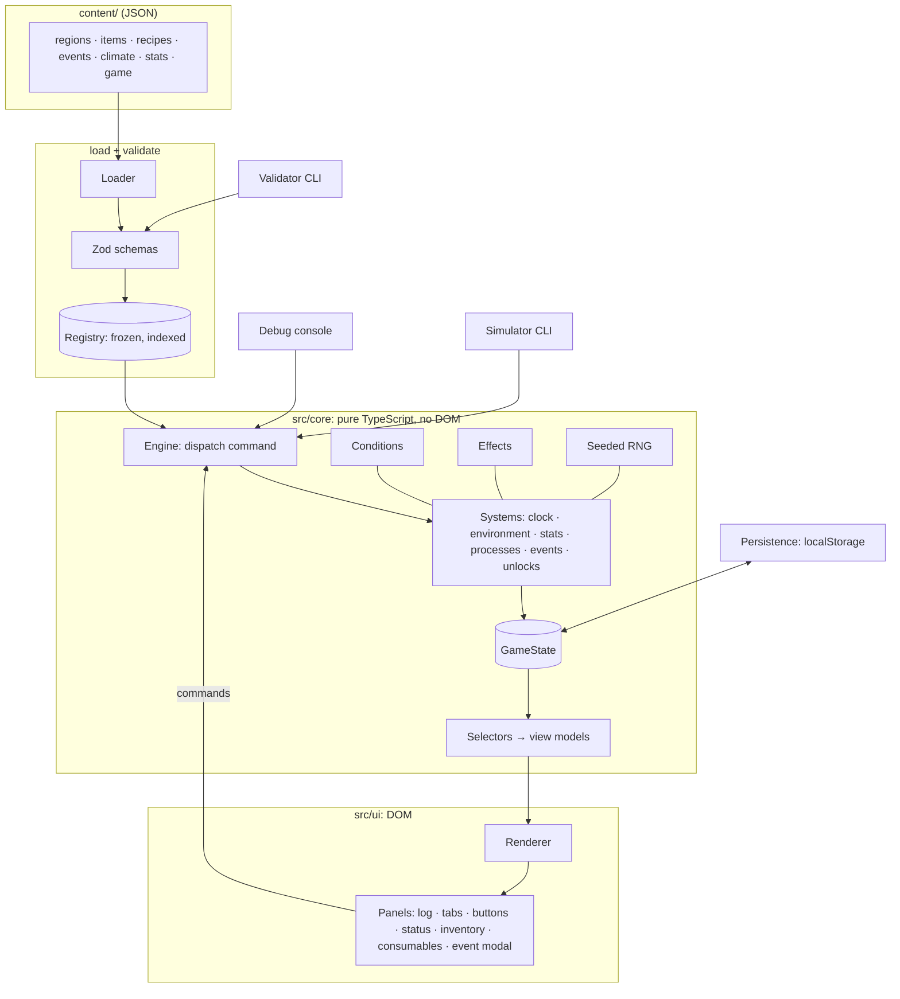
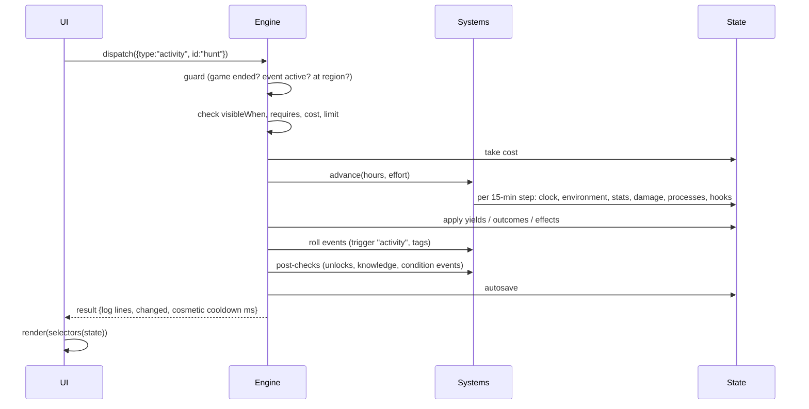

# Text Island: Technical Design Document

Version 0.1 (draft for review) · Companion to `docs/GDD.md` · Last updated: 2026-10-14

Status markers: **[decided]** confirmed by you · **[proposal]** my design · **[open]** needs a decision.

---

## 1. Goals and constraints

| # | Requirement | Source |
|---|---|---|
| R1 | All game content (regions, items, activities, buildings, recipes, processes, knowledge, events, weather, stats) is data. Adding a region needs **no engine code changes**. | your brief |
| R2 | Content is authored as **JSON** files. | [decided] |
| R3 | Logic inside data uses **structured conditions** (JSON objects), not code or expression strings. | [decided] |
| R4 | **TypeScript + Vite**, no UI framework, desktop browser, static hosting. | [decided] |
| R5 | **Action-based clock**: the simulation advances only through player commands. | [decided] |
| R6 | Deterministic and testable: the same seed and commands give the same result. | [proposal] |
| R7 | English now, translations later without refactoring content. | [decided] |
| R8 | Tooling: content validator CLI, in-game debug console, balance simulator. A visual editor comes later. | [decided] |
| R9 | Look and feel of *A Dark Room*: text, buttons, log, status panel, occasional illustrations. | [decided] |

### What we keep from *A Dark Room*, and what we change

| *A Dark Room* | Text Island |
|---|---|
| Global singleton modules per location | One engine; regions are data interpreted by generic systems |
| String-path state access through `eval` | Typed `GameState` object, mutated only by systems |
| Scattered `setTimeout` timers | One deterministic `advance(minutes)` step loop |
| Events as JS object literals with callbacks | Events as JSON with a fixed effect vocabulary |
| DOM holds part of the state | UI renders view models; it holds no game state |
| Data-driven scene graph for events | **Kept**, extended with conditions, cooldowns, weights |
| Cooldown buttons, fading log, reveal-by-unlock | **Kept** (cooldowns become cosmetic) |
| Versioned save migrations | **Kept** |

---

## 2. Architecture



**Rules:**

1. `src/core` never touches the DOM, `window`, `Date` or `Math.random`. That's why the simulator and tests can run it in Node.
2. The UI never changes state directly. It sends **commands** and renders **view models** from selectors.
3. Content is loaded once, validated, and frozen into a `Registry`. Systems read content only through the registry.

---

## 3. Project layout **[proposal]**

```
TextIsland/
├─ content/
│  ├─ game.json                  start state, constants, checkpoint rules
│  ├─ stats.json                 stat definitions, word bands, rates, damage rules
│  ├─ climate.json               day phases, seasons, weather, body temperature bands
│  ├─ knowledge.json
│  ├─ items/                     *.json, each file = array of items (grouped freely)
│  ├─ recipes/                   *.json, camp / workbench / forge / loom recipes
│  ├─ regions/                   one file per region (activities, buildings, events inside)
│  │  ├─ beach.json
│  │  ├─ forest.json
│  │  └─ ...
│  ├─ events/                    global.json, story.json, voyage.json
│  ├─ endings.json
│  └─ strings/                   en.json (generated), cs.json ... (translations)
├─ public/illustrations/         *.webp, transparent ink drawings
├─ schema/                       generated JSON Schemas (for VS Code + future editor)
├─ src/
│  ├─ core/
│  │  ├─ engine.ts               dispatch, command pipeline
│  │  ├─ state.ts                GameState type, createInitialState()
│  │  ├─ clock.ts                minutes → day, hour, phase, season
│  │  ├─ rng.ts                  seeded sfc32, serialisable
│  │  ├─ conditions.ts           evaluate() + explain()
│  │  ├─ effects.ts              effect handlers registry
│  │  ├─ outcomes.ts             yields, weighted tables
│  │  ├─ systems/                environment, stats, processes, events, unlocks, travel
│  │  └─ selectors.ts            view models for the UI and the simulator
│  ├─ content/
│  │  ├─ schema.ts               Zod schemas (single source of truth)
│  │  ├─ loader.ts               glob, merge, parse, index
│  │  ├─ registry.ts
│  │  └─ i18n.ts
│  ├─ persistence/               save.ts, migrations.ts, export.ts
│  ├─ ui/                        render.ts, components/, styles.css
│  ├─ debug/                     console.ts, overlay.ts
│  └─ main.ts
├─ tools/
│  ├─ validate.ts                npm run content:check
│  ├─ schema-export.ts           npm run content:schema
│  ├─ strings-extract.ts         npm run strings:extract
│  └─ simulate.ts                npm run sim -- --seeds 50
├─ tests/
└─ docs/  GDD.md · TDD.md
```

**Dependencies [proposal]:** `vite`, `typescript`, `zod`, `zod-to-json-schema`, `vitest`, `tsx` (run tools). Nothing else at runtime besides Zod.

---

## 4. Time and simulation

### 4.1 Clock

- `state.time` is an integer: **minutes since the start** (day 1, 00:00). Day, hour, phase and season are derived in `clock.ts` from `climate.json`.
- The engine advances in fixed steps of `game.stepMinutes` **[implemented: 15 minutes]**. A 3-hour action runs 12 steps; stat rates are per hour, so the step length does not change the balance. The validator rejects action times that are not a whole number of steps. Every system update happens per step, in a fixed order. This keeps results identical no matter how actions are split.

### 4.2 The step order

Implemented provisions: `game.json.provisions` defines the automatic hunger/thirst threshold (60) and shortage note texts. After stat rates and before damage in each clock step, and before post-command quest checks, the engine consumes carried items whose `consume.stats` reduce the relevant need. Strongest relief goes first, repeating until below the threshold or supplies run out. Automatic consumption applies the normal logs, effects, outcomes, and counters without advancing time recursively. Manual consumption suspends automation during its own clock step so one chosen meal is not doubled.

An unmet automatic need sets `auto_hunger_unavailable` / `auto_thirst_unavailable` flags; relief clears them. The drying-rack quest requires the hunger flag and carried raw fish or meat. Shortage notes are queued after successful commands; conditional preparation advice uses `provisions.preparation.when`. `GameState.provisionWarnings` remembers dismissed shortages across saves and rearms after relief; newly available preparation advice can also trigger a note. Raw meat and raw fish have no `consume` definition, so neither manual nor automatic consumption can eat them.

The shared beach drying rack retains its fish cycle. Raw meat's `dry` item action spends two portions, requires a sharp tool and an idle rack, sets `drying_meat`, and starts that same cycle. Conditional collection yields select dried fish or dried meat; starting fish and collecting clear the flag. Existing fish-rack saves default to fish.

```
for each step (15 minutes):
  1. clock.tick           timers and local building-ready notices
  2. environment.update   body warmth (1 band / hour)
  3. stats.update         per-step rates by effort × modifiers
  4. provisions           automatic food and water before damage
  5. stats.damage         damage rules from stats.json
  6. stats.regen          regeneration rules from stats.json
  7. death check          health ≤ 0 → stop
```

### 4.2b Energy and daily sleep [implemented]

`stats.json` makes energy the first status bar. Working costs its effort rate × elapsed hours. A single ×1.5 multiplier applies when hunger or thirst is at least 41; ×0.5 applies when both are at most 20; otherwise costs are unchanged. There is no hunger, thirst, or exhaustion damage rule. Rest and sleep have zero hourly energy gain. Edible items and direct drinking activities restore energy through their ordinary stat effects.

`game.sleep` defines the bed and shelter buildings, fire timer, wake time (06:00), cutoff (00:00), and six `recovery` entries. Each recovery reason owns its energy value and text: early warm sheltered bed (100), early unheated sheltered bed (80), late warm sheltered bed (80), late unheated sheltered bed (80), exposed bed (50), and ground (50). `sleepRecovery()` selects the reason once at bedtime; the journal and collapse modal use that same entry, even if fire expires overnight. The sleep activity is `global: true`; the engine and selectors can offer shared activities in any region. Its `visibleWhen: { built: "bed", here: true }` restricts voluntary sleep to a bed in the current region; UI visibility, direct command validation, and pre-sleep saves use the same condition. `{ built }` keeps its original global meaning when `here` is omitted. Map icons evaluate conditions at the represented place. Its duration is calculated to the next 06:00, including an early daytime bedtime. Midnight through 05:59 counts as late bedtime. Only the bed, shelter, and fire at the current location count. `{ sheltered: true }` checks either a local built shelter or the region’s `shelterWhen` condition; the discovered beach rocks provide natural shelter. Bed construction requires this condition, without a first-night gate. `shelterWhen` cannot itself contain `sheltered` (including nested conditions), preventing recursion. Sleeping simulates timers, production, needs, and health rules quietly, then sets morning energy and logs the new day and sleep summary. Cold remains a health hazard during sleep.

Non-sleep simulation stops at zero energy or the midnight cutoff and invokes the same overnight routine at the current location. `advance` returns false on death or interrupted work; `Result.interrupted` distinguishes collapse from `Result.died`. Callers stop before applying success rewards, travel, discoveries, or counters. `work` returns reserved input costs after a surviving collapse; interrupted collection leaves its production cycle available. After-action random events are skipped for interrupted work. A surviving collapse queues a priority note from `game.sleep.collapse`, explaining the missed bedtime and location alongside the new-day and sleep summary; it opens before task-completion notes. Voluntary sleep retains the manual pre-sleep save; every completed command, including collapse, autosaves the resulting state.

### 4.3 Paced actions

`content/game.json` → `cosmetic.msPerHour` is the shared rate, default 10000 ms per game hour, without reading-time additions or duration caps. `Engine.dispatch` remains synchronous for simulations and unit tests. The browser uses `prepareCommand` in `core/commands.ts`: an isolated engine records snapshots at each `stepMinutes` (15-minute) simulation step. The live engine receives the starting snapshot, then one recorded step every 2500 ms; the last step includes rewards, buildings, arrival, discoveries, and completion notes. Stats, provisions, local timers, and production advance with those steps. The renderer owns only the wall-clock schedule and progress bar; `main.ts` saves the completed result. Sleep snapshots are skipped, so voluntary sleep jumps instantly to the next 06:00 and collapse jumps overnight when its interrupting step is reached. Zero-time menus and event choices stay immediate. Restart/load cancels outstanding UI callbacks, and replacing the engine state invalidates prepared work. The autosave stays at the pre-command state until completion, so reloading cancels unfinished work without granting outputs or losing materials. `?speed=` multiplies real-time durations for tests. Menu/landmark bars use the persistent craft/build/look-around button; travel bars use the destination map button.

---

## 5. Game state

```ts
interface GameState {
  saveVersion: number;
  contentHash: string;            // hash of loaded content, for migration warnings
  seed: number;
  rng: [number, number, number, number];   // sfc32 state
  time: number;                   // minutes since start
  location: RegionId;
  stats: Record<StatId, number>;  // health, energy, hunger, thirst: 0..100
  body: { warmthBand: number };   // index into climate.bodyBands
  items: Record<ItemId, number>;
  seen: ItemId[];                 // ever owned (reveal rule)
  knowledge: KnowledgeId[];
  flags: string[];
  counters: Record<string, number>;
  regions: Record<RegionId, {
    unlocked: boolean; visited: boolean; explore: number; discoveries: DiscoveryId[];
  }>;
  buildings: Record<BuildingId, { level: number; count: number; progress?: number }>;
  processes: Array<{ uid: string; processId: ProcessId; startedAt: number; endsAt: number }>;
  activityUses: Record<ActivityId, { total: number; today: number; day: number }>;
  weather: { id: WeatherId; until: number };
  events: {
    history: Record<EventId, { count: number; lastAt: number }>;
    active: { eventId: EventId; sceneId: string } | null;
    queue: EventId[];
  };
  log: Array<{ at: number; text: TextRef }>;   // capped at 100
  ended: EndingId | null;
}
```

- Plain JSON-serialisable data. No classes, no Maps (simpler saves).
- `items` doubles as the stockpile **[decided: global stockpile]**. Storage caps exist only where content defines them (water containers, GDD §6.3).
- Clothing: the best owned item per clothing slot is worn automatically **[proposal]**. No equip UI needed for v1.

---

## 6. Content model

### 6.1 Conventions

- **IDs:** lowercase `snake_case`, **unique across all content kinds** (an item and a building can't share an id). This lets conditions refer to things without a type prefix and makes validator messages unambiguous.
- **Text:** written inline in English. Every text field becomes a translation key automatically (§10).
- **Comments:** JSON has none. Any key starting with `_` (for example `"_note"`) is allowed everywhere and ignored by the loader.
- **Amounts:** `{ "item_id": count }`.
- **Durations:** `hours` (decimals allowed: `0.5`).
- **Effort:** every action declares `effort`: `heavy`, `work`, `light` or `rest`. Stat drain per hour comes from `stats.json`, so authors never compute hunger or energy by hand. An optional `energy` adds an extra fixed cost.

### 6.2 Entity overview

| Kind | Lives in | Purpose |
|---|---|---|
| `game` | `game.json` | start region, start time, start items and stats, constants |
| `stat` | `stats.json` | stat definitions, word bands, rates, damage rules |
| `climate` | `climate.json` | day phases, seasons, weather types, body bands |
| `item` | `items/*.json` | materials, food, tools, clothing, containers, components |
| `knowledge` | `knowledge.json` | learned ideas used in conditions |
| `recipe` | `recipes/*.json` | crafting at a station (camp, workbench, forge, loom) |
| `region` | `regions/*.json` | region metadata **plus** its activities, exploration, discoveries, buildings, processes and events |
| `event` | `events/*.json` or inside regions | scenes and choices |
| `ending` | `endings.json` | final scenes |

A region file is self-contained, as you asked: description, unlock rule, activities, buildings with upgrades, processes and events in one place. Items and recipes shared by many regions live in their own files.

### 6.3 Conditions **[decided: structured]**

```ts
type Condition =
  | { all: Condition[] } | { any: Condition[] } | { not: Condition }
  | { item: ItemId; gte?: number; lte?: number }        // stockpile amount (default gte 1)
  | { seen: ItemId }                                    // ever owned
  | { knowledge: KnowledgeId }
  | { flag: string } | { counter: string; gte?: number; lte?: number }
  | { building: BuildingId; level?: number; count?: number }
  | { region: RegionId }                                // unlocked
  | { at: RegionId }                                    // player is there now
  | { discovered: DiscoveryId }
  | { explored: RegionId; gte: number }
  | { stat: StatId; gte?: number; lte?: number }
  | { warmth: BodyBandId[] }
  | { phase: PhaseId[] } | { season: SeasonId[] } | { weather: WeatherId[] }
  | { day: { gte?: number; lte?: number } }
  | { event: EventId; count?: number }                  // event seen
  | { process: ProcessId; state: "running" | "ready" };
```

Example: "wearing warm clothes and not in a blizzard":

```json
{ "all": [ { "item": "warm_clothes" }, { "not": { "weather": ["blizzard"] } } ] }
```

The evaluator also has `explain(condition)`. It returns the first unmet leaf as a short phrase for tooltips ("needs: spear", "only in daylight"). Each leaf type has one phrase template in the strings file.

### 6.4 Effects

```ts
type Effect =
  | { give: Amounts } | { take: Amounts }
  | { stat: Partial<Record<StatId, number>> }          // deltas
  | { learn: KnowledgeId } | { flag: string } | { unflag: string }
  | { count: string; add: number }
  | { discover: DiscoveryId } | { unlock: RegionId }
  | { explore: RegionId; add: number }
  | { wait: number }                                    // extra hours pass
  | { log: Text } | { image: ImageId }
  | { event: EventId }                                  // queue an event
  | { roll: Outcome[] }                                 // nested weighted choice
  | { checkpoint: true }
  | { end: EndingId };
```

Each effect type is one handler in `effects.ts`. **Adding a new effect type is the main reason to touch engine code** (§14).

### 6.5 Yields and weighted outcomes

```ts
type Yield   = { item: ItemId; min: number; max: number; chance?: number; when?: Condition };
type Outcome = { weight: number; when?: Condition; text?: Text; effects?: Effect[] };
```

Yields roll independently (like *A Dark Room* loot). Outcomes pick one entry by weight among those whose `when` is true.

### 6.6 Region file

```json
{
  "id": "forest",
  "name": "the forest",
  "title": "A Quiet Forest",
  "description": ["Tall trunks, close together.", "The sea is only a sound now."],
  "climate": { "baseC": 20, "daySwing": true },
  "travelHours": 1,
  "unlockWhen": { "discovered": "trail_into_trees" },
  "firstVisit": { "log": "The trees close in behind you.", "image": "forest_first" },

  "explore": {
    "name": "look around", "hours": 2, "effort": "work",
    "requires": { "any": [ { "phase": ["dawn", "day", "dusk"] }, { "item": "torch" } ] },
    "nothingLog": ["The trees all look the same now. Nothing new."],
    "discoveries": [
      { "id": "game_trail", "at": 2, "text": ["Hoof prints in the mud. A trail used often."] },
      { "id": "tall_pines", "at": 4, "text": ["A stand of pines, straight as masts."] },
      { "id": "running_water", "at": 6, "text": ["Somewhere ahead, the sound of running water."],
        "effects": [ { "startQuest": "follow_the_water" } ] }
    ]
  },

  "activities": [
    {
      "id": "gather_firewood", "name": "gather firewood",
      "hours": 1, "effort": "work",
      "yields": [ { "item": "firewood", "min": 4, "max": 6 } ],
      "eventChance": 0.05,
      "log": ["Dry branches snap underfoot.", "An armful of deadwood."]
    },
    {
      "id": "hunt", "name": "hunt",
      "hours": 3, "effort": "heavy",
      "visibleWhen": { "discovered": "game_trail" },
      "requires": { "all": [ { "item": "spear" }, { "not": { "phase": ["night"] } } ] },
      "outcomes": [
        { "weight": 5, "text": "The spear finds its mark.",
          "effects": [ { "give": { "raw_meat": 3, "hide": 1 } } ] },
        { "weight": 4, "text": "Nothing. The forest went quiet when you arrived." },
        { "weight": 1, "text": "A tusk catches your leg.",
          "effects": [ { "stat": { "health": -15 } } ] }
      ],
      "eventChance": 0.15, "eventTags": ["hunt"]
    },
    {
      "id": "fell_tree", "name": "fell a tree",
      "hours": 4, "effort": "heavy",
      "requires": { "any": [ { "item": "stone_axe" }, { "item": "iron_axe" } ] },
      "yields": [
        { "item": "log", "min": 1, "max": 1, "when": { "not": { "item": "iron_axe" } } },
        { "item": "log", "min": 2, "max": 3, "when": { "item": "iron_axe" } }
      ]
    }
  ],

  "buildings": [
    {
      "id": "charcoal_clamp", "name": "charcoal clamp",
      "description": "A mound of wood under turf, smouldering for a day.",
      "visibleWhen": { "seen": "clay" },
      "max": 3,
      "levels": [
        { "cost": { "firewood": 20, "clay": 5 }, "hours": 4, "effort": "heavy",
          "log": "You pile the wood and seal it with turf and clay." }
      ]
    }
  ],

  "processes": [
    {
      "id": "burn_charcoal", "name": "burn charcoal", "building": "charcoal_clamp",
      "inputs": { "firewood": 15 }, "hours": 24,
      "outputs": [ { "item": "charcoal", "min": 5, "max": 7 } ],
      "startLog": "Smoke leaks from the mound.",
      "doneLog": "The clamp has burned down. Charcoal, black and light."
    }
  ],

  "events": [
    {
      "id": "wild_boar", "title": "A Wild Boar",
      "trigger": "activity", "tags": ["hunt", "explore"],
      "weight": 3, "cooldownHours": 48,
      "image": "boar",
      "scenes": {
        "start": {
          "text": ["The undergrowth bursts open.", "A boar, head low, tusks yellow."],
          "choices": [
            { "id": "fight", "text": "Stand with the spear",
              "requires": { "item": "spear" },
              "next": [ { "weight": 6, "scene": "won" }, { "weight": 4, "scene": "gored" } ] },
            { "id": "climb", "text": "Climb a tree", "next": "climbed" }
          ]
        },
        "won":     { "text": ["It goes still."], "effects": [ { "give": { "raw_meat": 6, "hide": 2 } } ],
                     "choices": [ { "id": "leave", "text": "Carry it home", "next": "end" } ] },
        "gored":   { "text": ["The tusk opens your thigh. It runs."], "effects": [ { "stat": { "health": -25 } } ],
                     "choices": [ { "id": "leave", "text": "Limp away", "next": "end" } ] },
        "climbed": { "text": ["It circles for an hour, then loses interest."], "effects": [ { "wait": 1 } ],
                     "choices": [ { "id": "leave", "text": "Climb down", "next": "end" } ] }
      }
    }
  ]
}
```

### 6.7 Activity schema

| Field | Type | Meaning |
|---|---|---|
| `id`, `name` | string | |
| `hours`, `effort`, `energy?` | number, enum, number | Time and stat cost |
| `visibleWhen?` | Condition | Button exists only when true (hidden content) |
| `requires?` | Condition | Button enabled only when true; `explain()` gives the tooltip reason |
| `cost?` | Amounts | Consumed items |
| `yields?` / `outcomes?` / `effects?` | see §6.5 | Results |
| `limit?` | `{ total?, perDay? }` | Finite activities (wreck search: `total: 6`) |
| `sequence?` | Outcome[] | Scripted results in order, one per use (wreck finds) |
| `eventChance?`, `eventTags?` | number, string[] | Event roll after the action |
| `log?` | Text or Text[] | One line picked at random |

**Region exploration** (`explore`) is the region's "look around" button **[implemented]**: `{ name, title?, view: [{ text, when? }], nothingLeft?, landmarks: [Landmark] }`. The `explore` command takes no time and opens a pop-up (`events.active.id = "explore:<region>"`): its text is every `view` line whose `when` holds (plus `nothingLeft` when no landmark is left), its choices the landmarks not explored yet whose `visibleWhen` holds, with their time, and *close*. A landmark is `{ id, label, hours, effort, visibleWhen?, requires?, requiresText?, text, effects? }`; choosing it advances time, marks the discovery (`{ "discovered": id }`; `{ "explored": region, "gte": n }` counts them), logs `text` to the journal, applies `effects`, and shows `text` with *close*. Closing that page runs "after explore" event triggers (keys `"explore"` and the landmark id). The button has `badge: "*"` while any landmark is offered. Tests: `lookAround(e)` in `tests/helpers.ts` explores the next landmark in content order.

### 6.8 Buildings **[implemented]**

`content/buildings/*.json`: a list of buildings. A building is put up in a place and produces over time in **cycles the player starts** (no idle income).

```json
{
  "id": "fish_trap", "name": "fish trap", "icon": "fish", "hint": "…",
  "places": [{ "region": "beach", "when": { "discovered": "school_of_fish" } }, { "region": "meadows", "when": { "discovered": "river" } }],
  "availableWhen": { "any": [{ "quest": "build_fish_trap", "is": "active" }, { "quest": "build_fish_trap", "is": "done" }] },
  "build": { "hours": 1, "effort": "work", "cost": { "willow_twigs": 20 }, "log": "…" },
  "cycle": {
    "start": { "id": "set_trap", "label": "set", "hours": 0.25, "effort": "light", "log": "…" },
    "hours": 2, "batches": 3, "repeat": true,
    "collect": { "id": "empty_trap", "label": "empty", "hours": 0.25, "effort": "light", "yields": [{ "item": "raw_fish", "min": 1, "max": 1 }] },
    "words": { "idle": "not set", "working": "set", "ready": "{n} fish" },
    "readyLog": "Something thrashes in the trap."
  }
}
```

- **Where:** `places` lists the regions (each with an optional `when`); one can stand in each (state key `"<id>@<region>"` in `state.buildings`, `{ builtAt, startedAt? }`). `availableWhen` gates the build button (usually: its task has started).
- **Building it:** the `build` step (`requires`, `cost`, `hours`, `effort`, `log`, `effects`) runs from the build menu where you are. `max` (default 1) is how many can stand in one place (fish trap, corn field: 3); state `{ count, builtAt, startedAt? }`. Several in a place share one cycle: `start` and `collect` cost and take `count` times as much, and each batch yields `count` times; a new one joins a cycle already running. A quest with `build: "<id>"` names its building goal; costs appear in the build menu, not the task list. The `{ "build": id }` effect adds one where you are without the step (events); `{ "startCycle": id }` starts the cycle here (the corn field is sown as it is dug). The `building` command (`step: "start" | "collect"`) is the button in the buildings panel.
- **Cycles:** `start` (cost, time) sets `startedAt` when its work ends. Every `hours` one batch is ready, up to `batches` (default 1); nothing ticks, batches are worked out from the clock (`batchesReady`). `collect` applies its `yields` / `outcomes` once per batch ready, plus `effects`; then it is idle, or with `repeat` it counts again from the end of the collect. `readyLog` is written when the first batch is ready while you are there (not while asleep). Step ids count like activity ids (`did`, `today`, event `after`); building ids too (when built).
- **Effects on the rules:** `warmthC` adds to the felt temperature in its place (the shelter, +3). Conditions include `{ "built": id }` (any place), `{ "built": id, "here": true }` (current place), `{ "sheltered": true }` (local built or natural shelter), and `{ "building": id, "is": "idle" | "working" | "ready" }`. Bed health regeneration is local; morning energy comes from `game.sleep.recovery`, not hourly multipliers.
- **Local timers:** `local: true` on a timer stores one value per region (`fire@beach`, `fire@forest`, etc.). Effects, conditions, warmth, cooking, and status resolve the current region; all regions’ timers advance, with warnings only for the current area. A building’s optional `timer` supplies its displayed state (campfire: out/burning/roaring). `initializeTimers` migrates a legacy shared fire to its configured region (beach), adding a campfire only if that old fire was burning; it never invents fire for an old bed save. Timer `building` and building `timer` references are validated.
- **View:** `view.buildings` lists, for the current place, the buildings standing here (`label` with ×count; `word`: `word` or the cycle's words, working with the time to the next batch, e.g. "growing · 2d 23h"; the step's button with the scaled time and cost). Panel `#buildingsBox` / `#buildings` in every layout (hidden when empty). Built buildings with an `icon` show in the map's hover icons. The task note says "{building} built." (`game.tasks.built`).
- **Validator:** places, conditions, costs, yields, effects and step hours (whole clock steps) are checked; `{ "building": id, "is": … }` and `startCycle` need a building with a cycle; a quest's `build` must exist.

The 11 buildings in `content/buildings/camp.json`:

| Building | Place | Task starts when | Build | Cycle |
|---|---|---|---|---|
| campfire | beach, forest, meadows | beach rocks discovered, or either other area reached | 2 stones, 15m | none; build unlit, light and stoke locally |
| shelter | forest, meadows | build available immediately; task after first night outside shelter | 4 logs, 2h | none; +3 °C, allows a bed |
| bed | any sheltered area | built or natural shelter available | 2 logs, 4 firewood, 1h | none; enables sleep, +1 health/h while sleeping |
| drying rack | beach | automatic eating fails with raw fish or meat carried | 2 logs | hang 2 raw fish or dry 2 raw meat → 12h → dried food |
| rain barrel | sheltered beach | built shelter, or natural shelter after the first night | 3 logs | set out → 12h → drink (thirst −45), repeats |
| fish trap | beach shallows or the river | you found the river | 20 willow twigs | set → 1 fish / 2h, up to 3, stays set |
| snares | forest | you found the small trails (day 2+) | 1 rope, 2 firewood | set → 12h → maybe a rabbit (raw meat), repeats |
| mushroom logs | forest | after collecting wood 3 times | 2 logs | soak (needs the spring) → 2 days → 3–5 mushrooms |
| corn field | meadows | you found the flat ground | needs a hoe, 2 corn (sown at once) | sow 2 corn → 3 days → 6–10 corn |
| bee hive | meadows | you found the humming (after the bushes) | 2 logs | lure with 2 berries → 3 days → 1–2 honey (smoke: 1 firewood), repeats |
| fish weir | the river | you emptied the trap twice | 6 stones, 2 logs | close → 12h → 2–4 fish, repeats |

Materials and tools: *logs* (`timber`) only with the **axe** (*chop wood* in the forest); the axe (craft menu: 2 firewood, 2 stones) is offered once the task *cut logs* (needs: axe) starts, with any task needing logs; *stones* under the low cliff (*pick up stones*, once *cut logs*, the corn field or the weir task has started); the **hoe** (1 log, 1 stone) is offered with the corn field task (needs: hoe); *willow twigs* by the river (*cut willow twigs*: 10 in 30 min); the **rope** (`cordage`; craft menu: 4 bark strips, 3 h; *strip bark* in the forest needs something sharp, 1 h) climbs the cliff (`cliff_top` requires it; task *climb the cliff*, needs: rope) and makes the snares; *corn* from the wild corn (*gather corn*), roasted at the fire; raw meat cooked at the fire.

The original design (levels, modifiers) is kept below for later.

**Modifiers** are the only way buildings and items change the rules. The engine sums them:

| Modifier | Effect |
|---|---|
| `localHeatC` | Added to environment °C while the player is in that region |
| `insulationC` (items, by `slot`) | Added to felt °C; best item per slot counts |
| `sleep` | Energy and health recovery per hour of sleep in that region |
| `storage` | Capacity for capped items (e.g. `{ "fresh_water": 4 }` per clay jar) |
| `travelFactor` | Multiplies travel hours to that region (paths) |
| `yieldFactor: { activity, factor }` | Multiplies yields of an activity (mine shaft) |
| `hoursFactor: { activity, factor }` | Multiplies action time (better tools) |
| `statRate: { stat: factor }` | Multiplies a stat's drain rate (shade, hat) |

### 6.9 Items, recipes, processes, knowledge

```json
[
  { "id": "coconut", "name": "coconut", "plural": "coconuts", "category": "food",
    "consume": { "verb": "crack a coconut", "hours": 0.5, "stats": { "hunger": -10, "thirst": -20 } } },
  { "id": "fresh_water", "name": "fresh water", "category": "water", "capped": true,
    "consume": { "verb": "drink", "hours": 0.25, "stats": { "thirst": -35 } } },
  { "id": "clay_jar", "name": "clay jar", "category": "container",
    "modifiers": { "storage": { "fresh_water": 4 } } },
  { "id": "warm_clothes", "name": "warm clothes", "category": "clothing", "slot": "body",
    "modifiers": { "insulationC": 12 } }
]
```

```json
{ "id": "craft_spear", "makes": { "spear": 1 }, "station": "camp",
  "cost": { "driftwood": 2, "sharp_stone": 1, "cordage": 1 }, "hours": 1, "effort": "light",
  "log": "A straight shaft, a lashed point. It will do." }
```

- **Thoughts and today's memories [implemented]:** an activity can list `thoughts`: groups `{ intro?, max?, lines: [{ text, when? }], otherwise? }`, logged before the activity, worked out before it changes anything. Each group logs up to `max` lines whose `when` holds (in order), with `intro` first, or `otherwise` if none holds. The state keeps `today`: counts of what was done (the same keys as `did`), found, walked to and finished since the last sleep; `{ "today": id, gte?, lte? }` tests it, and an activity with effort `sleep` clears it. `afterwards` (same shape) is logged after the activity, from the state it left. While an activity with effort `sleep` advances time the engine logs nothing (damage, timer warnings) except death; the sleep activity's `afterwards` sums up the night instead: when you wake, the worst body state first, the fire. The sleep activity uses one group for tiredness (`{ "stat": "energy", "lte": 20 }`…) and one for up to three memories of the day.
- **Text variants [implemented]:** every journal text is `Text` = a passage or a list of variant passages (lists no longer mean "lines in order": descriptions, discoveries and the intro are single passages). `chooseText` (src/core/text.ts) picks one with the seeded rng, never the variant shown last for that text (`state.lastText`, keyed by the first variant), so saves replay identically. Engine-written lines live in `game.json` → `journal` (`walkTo`, `wayOpens`, `nothingNew`; `{place}` is filled in). Variant mode `"first"` always picks the first variant: unit tests use it via `tests/setup.ts`, the browser test via `?variants=first`; `tests/variants.test.ts` checks the variety itself.
- **Route map [implemented]:** the places panel (`#tabs`) draws a grid map. A region's optional `map: { x, y }` (grid cells, y down) places it; without one, regions line up by `order`. The camp is the region with `travelHours` 0; each other region gets a path from it, labelled with its `travelHours` (travel goes through the camp, so this matches the walking times). Known regions are buttons (click = travel); locked ones are "?" at the end of a dashed path, once their optional `hintWhen` holds (default: from the start; a region whose `hintWhen` is false is not on the map and takes no space in the grid, e.g. the meadows until the low cliff is found). Cells are all the same size (`--map-cell`, `--map-row`); the view (`.map-view`) is as wide as its panel and the grid (`.map`, kept between renders) hangs from its middle, shifted by the current cell (`--hc`, `--hr`), so the place you are in is centred and walking slides the map (a CSS transition; the view's height is symmetric around the current row). The fog is a mask on the view (`--fog-x` × `--fog-y`): clear up to 1.6 cells from the centre, transparent from 2.6; nodes 3+ cells away get `.far` (no pointer events, not focusable). On phones the horizontal fog is the outer 16% of the view. Map icons: an activity's optional `icon` (enum `Icon` in schema.ts, drawings in `src/ui/icons.ts`); `tabs[].icons` lists, per place, the icons of activities whose `visibleWhen` holds (each once, in enum order); hovering or focusing a node shows them in `#mapTip`, which sits outside the masked view. A region new on the map gets the class `new` (a short pulse) once no pop-up covers the map, until the next non-choose command (`UI.pulse`). View model: `tabs` (nodes with `col`, `row`, `hours` from here) and `map` (`cols`, `rows`, `paths`, `unknown`).

**A new place [implemented]:** regions unlocked during a command (by `unlockWhen` or an `unlock` effect) are offered in the pop-up that opened them (`Engine.offerNewPlaces`): a look-around finding gets `game.newPlace.text` ({place}) as an extra paragraph (`active.hint`, not written to the journal) and a `go:<region>` button per place (`active.go`, label `newPlace.go`, with the walking time) before *close*; a task note from the same command gets the buttons (its text already says the way opens); otherwise a note titled `newPlace.title` with the text and the buttons. `go:<region>` closes the pop-up and travels there (after-explore events then follow).
- **Arrival view [implemented]:** a region can list `arrive` lines, `{ "text": Text, "when"?: Condition }`. On every arrival after the first (which logs `description` and `firstVisit.log`), the engine logs each line whose `when` holds, in order, so the view reflects time of day, discoveries and timers, e.g. `{ "text": "Smoke rises from the ring of rocks.", "when": { "all": [ { "discovered": "rock_shelter" }, { "timer": "fire" } ] } }`. The validator checks the conditions.
- **Item actions [implemented]:** an item can list `actions` — controls labelled with the action's `label`, grouped by building or carried item, e.g. raw fish → `{ "id": "cook", "building": "campfire", "label": "cook", "hours": 0.5, "visibleWhen": { "timer": "fire" }, "effects": [ { "give": { "cooked_fish": 1 } } ] }`. Each use spends one of the item (`uses`, default 1; `0` keeps it, e.g. the water can's *fill*) plus any `cost`; the `itemAction` command runs it. An optional validated `building` id on an item action places it under that local building, with the item name in its label (e.g. “cook raw fish”). Actions without a building, such as filling the water can, appear under the carried item in the consumables section. All items with `consume` or `actions` are listed in consumables, even when their controls are unavailable at the current location. Other possessions are listed in inventory with counts only. An item can have `max` (e.g. 4 drinks of `can_water`): getting more stops there. Eating (`consume`) is a button of the same kind.
- `station` is `camp` (always available at the beach) or a building id (`workbench`, `forge`, `loom`). The craft menu is shown in the region where the station is.
- Processes (§6.6) belong to a building. Several processes per building are allowed (the kiln fires pots *or* bricks).
- Knowledge: `{ "id": "boiling_water", "name": "boiling water", "learnWhen": { "item": "clay_pot" }, "log": "Water boiled in clay will not make you sick." }`. It can also be granted by the `learn` effect.

### 6.10 Events

**[implemented, simpler than the design below]** `content/events/*.json` holds a list of events: `{ id, title, trigger, when?, repeat?: { cooldownHours }, scenes }`. Triggers: `"start"` (a new game opens it before the first journal line; `game.start.log` is written when it ends), `{ "at": { day, hour } }`, `{ "when": Condition }` (both checked after each action), `{ "after"?: [activity id | tag | item id | "explore" | "travel"], "chance" }` (a seeded roll after a matching action). An event happens once unless it has `repeat`. Scenes: `{ text, effects?, choices?, close? }`; the event opens on `start`. A choice: `{ id, label, visibleWhen?, requires?, requiresText?, effects?, next? }` (no `next` ends the event); a scene without choices shows one button, `close` (default label "close"), that ends it. While an event is open the engine refuses every command except `{ type: "choose", choice }`. Each scene's text is logged when the scene opens, one journal paragraph per paragraph (blank line) of the text, before the choice's effects and whatever comes next (for the shipwreck: the storm, the swim, then `game.start.log`). Ordinary event choices take no game time and return no progress bar; landmark, menu, and travel choices use the shared timed-command rate. New effect `{ "unlock": regionId }`. Quest `action` may be a list of alternatives with `visibleWhen` (first visible wins). The design below (weights per scene, phase/sleep triggers, priorities, images) is not built yet.

| Field | Meaning |
|---|---|
| `trigger` | `activity`, `explore`, `arrive`, `phase` (with `phases`), `sleep`, `condition`, `manual` |
| `tags?` | For `activity`: match `eventTags` of the action (empty = any action in scope) |
| `regions?` | Scope; events inside a region file default to that region; global events omit it |
| `when?` | Condition |
| `weight`, `cooldownHours?`, `once?` | Weighted pick, minimum hours between repeats, one-time |
| `chance?` | For `phase` and `sleep` triggers: probability per occurrence |
| `priority?` | `condition` events with priority interrupt immediately (story beats) |
| `image?` | Illustration on the start scene |
| `scenes` | `start` is required. Scene: `text[]`, `image?`, `effects?` (on enter), `choices[]` |
| choice | `id`, `text`, `requires?` (shown disabled with reason), `visibleWhen?`, `cost?`, `effects?`, `next`: scene id, `"end"`, or weighted list `[{ weight, when?, scene }]` |

While an event is active, every command except `choose` is rejected. An event stack is not needed. Queued events wait in `events.queue` and open after the current one closes.

### 6.10b Quests **[decided]**

**Better sleep [implemented]:** the task starts once `survive_first_night` is done. Its hint asks for a bed and a lit fire in a sheltered area; completion requires `{ sheltered: true }`, `{ built: "bed", here: true }`, and `{ timer: "fire" }` together at the current location. Separate areas cannot contribute partial facilities.

**Task notes [implemented]:** when a quest completes, the engine queues a note (`state.events.notes`) that opens as a pop-up when the command is over (it blocks the game like an event; `close` ends it). Title `game.tasks.title` ({task}); text: the quest's `doneLog` (already in the journal, not logged again) and what changed since the command began: items gained (`tasks.gained`, {item} {where}) and used (`tasks.used`), places opened (`tasks.opened`), buildings built (`tasks.built`), and, when crafting or building finished it, actions now possible here (`tasks.possible`). Tests: `startGame` closes notes automatically unless `{ keepNotes: true }`.

Example (not shipped; the current content has only *survive the first night*):

```json
{
  "id": "light_a_fire",
  "title": "light a fire",
  "hint": "The light is going. Gather wood and make a fire before dark.",
  "trigger": { "when": { "all": [ { "reached": { "day": 1, "hour": 16 } }, { "not": { "did": "light_fire" } } ] } },
  "completeWhen": { "timer": "fire" },
  "startLog": "The sun is low. It will be cold soon.",
  "doneLog": "Warmth, and a little light against the dark.",
  "effects": []
}
```

- Files: `content/quests/*.json`, each an array. The tasks panel lists active quests in file order.
- Tasks are goals, not recipes **[implemented]**: no task asks you to craft a tool; a task that needs tools says so in `needs` (items or buildings; a nested list = any one of them: `[["fishing_spear", "fish_trap"]]`), retained as metadata in `view.quests[].needs`. Optional `build: <building>` identifies its building goal. The task panel displays titles only; requirements and costs appear in craft/build menus. Tasks have no buttons: things are made in the craft and build menus (below). The quest finishes through its normal `completeWhen` (e.g. `{ "seen": "raw_fish" }`, `{ "built": "shelter" }`). The validator checks `needs` ids.

**Tool tags [implemented]:** requirements name a use, not an item. `game.json` → `tools` defines the tags (`sharp`, `fire_starter`) with a `label` (shown next to items that have it: *knife · sharp*) and `needs` (what `explain` says: "needs something sharp"). An item has `tool: { tags, amount?, hoursFactor? }`: knife `sharp`; rock knife `sharp`, ×2; matches `fire_starter`; stones and firewood `fire_starter` with `amount: 2`. The condition `{ "tool": tag }` holds when you have `amount` of any item with the tag. An action whose `visibleWhen` / `requires` ask for a tool (not under `not`) takes the quickest such item's `hoursFactor` times as long (`toolFactor`, `Engine.hoursFor`; activities, recipe ways, item actions, landmarks, building steps; the shown times too). When the way differs by item (texts, chance), content uses separate activities or recipe ways with item conditions: the three *light fire* activities (`light_fire` matches, `strike_fire` 2 stones, `make_fire` friction, which requires `{ "tool": "fire_starter" }` and 5 firewood: 3 to burn, 2 sticks), the spear's two ways (rock knife texts when it is the only sharp thing).

**Craft and build menus [implemented]:** `{ type: "menu", menu: "craft" | "build" }` opens a pop-up (`events.active.id = "menu:craft"`; no time; with nothing in it, the text is `menus.<menu>.empty` and only *close*). Its choices: for craft, the recipes (`content/recipes/*.json`: `{ id, item, count?, label?, availableWhen?, multiple?, ways: [{ visibleWhen?, hours, effort, requires?, requiresText?, cost?, log?, effects? }], tags? }`; the first way whose `visibleWhen` holds is used, e.g. the spear with the knife or a stone) that are available and not had yet (unless `multiple`); for build, the buildings `buildable` here (available, a place here, fewer than `max` here). Each choice has its `time` and a `tooltip` (cost, time; the building's hint), and is disabled with the reason when it can't be made. Choosing one closes the pop-up and makes it like an action (time, progress bar, `did`/`today` with the recipe or building id, event `after` keys); the task note then lists what is now possible. The view places both menus beside look around in the main action row (`menu: true`; badge `*` when something can be made now), from the moment it has something (`Engine.menuShown`: a recipe available, or a building available anywhere) and from then on in every place (flag `menu_craft` / `menu_build`). The classic layout is 1040px wide (slimmer side columns below 1080px) so the three fit in its middle column down to about 900px.
- Item grouping follows capabilities: `consume` or a nonempty `actions` list places an item in consumables; other items go in inventory. Task-gain notes name the same section.
- `trigger`: `"start"`, `"manual"` (only via the `{ "startQuest": id }` effect) or `{ "when": Condition }`.
- New condition leaves: `{ "did": id, "gte"? }` counts finished activities, item uses and **tags** (`"tags": ["drink"]` on an activity or a `consume` block); `{ "reached": { "day", "hour"? } }` compares the clock; `{ "quest": id, "is": "active" | "done" }` chains quests.
- State: `quests: { [id]: { status, startedAt, doneAt? } }` and `counters: { "did:<key>": n }`. Both are part of the saved game, so loading it rolls quests back too.
- The engine runs `syncQuests()` after every command (and at a new game): start triggered quests, finish active ones whose goal is met, apply their effects. It repeats up to 10 passes, because finishing one quest can start another.
- Validator: unknown `did` keys, unknown quest ids, and `"manual"` quests that no effect ever starts are errors. A tag may not share its name with an id.

### 6.11 Climate and stats files (excerpt)

```json
{
  "_note": "phases are hour ranges; an id may repeat to wrap around midnight",
  "phases": [
    { "id": "night", "from": 0, "to": 5, "tempC": -6 },
    { "id": "dawn", "from": 5, "to": 7, "tempC": -3 },
    { "id": "day", "from": 7, "to": 18, "tempC": 0 },
    { "id": "dusk", "from": 18, "to": 20, "tempC": -2 },
    { "id": "night", "from": 20, "to": 24, "tempC": -6 }
  ],
  "seasons": [
    { "id": "spring", "days": 20, "tempC": 0,
      "weather": [ { "id": "clear", "weight": 5 }, { "id": "rain", "weight": 3 }, { "id": "storm", "weight": 1 } ] }
  ],
  "weather": [ { "id": "rain", "name": "rain", "tempC": -3, "rollHours": 6 } ],
  "bodyBands": [
    { "id": "freezing", "belowC": 5 }, { "id": "cold", "belowC": 15 },
    { "id": "comfortable", "belowC": 28 }, { "id": "hot", "belowC": 34 }, { "id": "overheating" }
  ]
}
```

```json
{
  "stats": [
    { "id": "thirst", "start": 40, "words": [
      { "upTo": 25, "word": "quenched" }, { "upTo": 50, "word": "dry" },
      { "upTo": 80, "word": "thirsty" }, { "upTo": 100, "word": "parched" } ] }
  ],
  "ratesPerHour": {
    "heavy": { "hunger": 4, "thirst": 6, "energy": -8 },
    "work":  { "hunger": 3, "thirst": 5, "energy": -5 },
    "light": { "hunger": 2, "thirst": 4, "energy": -2 },
    "rest":  { "hunger": 2, "thirst": 3, "energy": 0 },
    "sleep": { "hunger": 1.5, "thirst": 2, "energy": 0 }
  },
  "multipliers": [ { "when": { "warmth": ["hot"] }, "stat": "thirst", "factor": 1.3 } ],
  "damage": [
    { "when": { "warmth": ["freezing"] }, "healthPerHour": -3 }
  ],
  "regen": [ { "when": { "all": [ { "stat": "hunger", "lte": 50 }, { "stat": "thirst", "lte": 50 }, { "warmth": ["comfortable"] } ] }, "healthPerHour": 1 } ]
}
```

Damage, regeneration and multipliers are themselves conditions. New survival rules are data.

---

## 7. Command pipeline



**Commands:** `activity`, `explore`, `travel`, `returnToCamp`, `build`, `craft`, `startProcess`, `collect`, `consume`, `rest`, `sleep`, `choose` (event choice), plus debug commands. Each command is a small handler. All share the `guard → check → pay → advance → resolve → events → post-check → save` pipeline.

**Post-checks** run after every command:

1. Regions whose `unlockWhen` became true → unlock, log, image.
2. Knowledge whose `learnWhen` became true → learn.
3. `condition` events whose `when` became true → queue (respecting `once`).
4. Newly owned items → add to `seen` (drives the reveal rule).

These are evaluated over the whole registry after every command. With a few hundred entities that's well under a millisecond, so no dependency tracking is needed.

---

## 8. Selectors and view models

The UI and the simulator read the same view models.

```ts
interface RegionView {
  id: RegionId; name: string; title: string; description: string[];
  travelHours: number; isHere: boolean;
  actions: ButtonView[];     // explore + activities
  build: ButtonView[];       // buildings and next upgrade level
  craft: ButtonView[];       // recipes for stations in this region
  running: Array<{ name: string; hoursLeft: number; ready: boolean }>;
}
interface ButtonView {
  id: string; label: string; enabled: boolean;
  reason?: string;           // explain() of the first unmet requirement
  tooltip: { hours: number; effort: Effort; cost: Amounts; outputs?: string[] };
  cooldownMs: number;
}
interface StatusView {
  day: number; time: string; phase: string; season: string; weather: string;
  words: Record<StatId, { word: string; trend: "up" | "down" | "steady" }>;
  inventory: Array<{ id: ItemId; label: string; count: number; tags: string[] }>;
  consumables: Array<{ id: ItemId; label: string; count: number; tags: string[]; actions: ButtonView[] }>;
}
```

**Reveal rule [proposal, GDD §13]:** a recipe or building is visible when `visibleWhen` is true **or**, if it has no `visibleWhen`, when every cost item is in `seen`. It is enabled when `requires` is true and the cost is affordable.

---

## 9. Randomness and determinism

- `rng.ts` implements **sfc32**, seeded at new game. The 4-number state is saved in `GameState`.
- All game randomness goes through `ctx.rng`. Lint rule: `Math.random` is forbidden in `src/core`.
- Because checkpoints contain the RNG state, a reload replays the same rolls for the same choices (anti-save-scum, GDD §6.4).
- The simulator runs many seeds; any bug report can include the seed and the command log to reproduce it exactly.

---

## 10. Localisation **[decided: English now, more later]**

- Authors write English inline. They never manage keys.
- `npm run strings:extract` walks the registry and writes `content/strings/en.json`. Keys are derived from the content path, for example `region.forest.description.0` or `event.wild_boar.scenes.start.choices.fight.text`.
- A translation file (`cs.json`) uses the same keys. At runtime `t(key, inlineText)` returns the translation if one exists, else the inline English.
- Placeholders use `{name}` syntax (`"you collect {count} {item}"`). Plurals: items have `name` and `plural`. More complex plural rules (Czech has three forms) can be added later with `Intl.PluralRules` and a `{count, plural, ...}` form **[open: needed only when a second language starts]**.
- Risk: renaming an id breaks its translation keys. The validator warns about orphaned translation keys.

---

## 11. Persistence

```ts
interface SaveFile {
  saveVersion: number;
  current: GameState;       // the autosave: after every command; the saved game: on save. and before sleep
  savedAt?: string;         // the saved game only
}
```

- Storage: `localStorage["textisland.save"]` (autosave) and `localStorage["textisland.saved"]` (the saved game). Export and import as base64 JSON text (a menu item, like *A Dark Room*).
- **[implemented, replaces checkpoints]** Death is permanent: the engine sets `state.death = { time, cause, lines }` (the end screen's lines, chosen once: `game.ending.survived` with `{time}`/`{day}`, and `ending.cause` with `{cause}`). The cause is the damage rule hurting most when health hits 0 (`cause` on `stats.damage`; ties are joined with "and"), else what the command was (an event's title, "bad <food>"), else `ending.defaultCause`. Storage (src/persistence/save.ts): the autosave `textisland.save` after every action (a reload continues; a death stays), and the saved game `textisland.saved`, written by *save.* in the menu and just before every sleep (`engine.willSleep(cmd)`); the end screen offers *load the saved game* and *start again*.
- **Migrations:** an ordered list `migrations[n](save) → save`. Run on load until `saveVersion` matches.
- **Content drift:** if `contentHash` changed, the loader drops ids that no longer exist (with a console warning) and fills new stats with their start values. Content changes during development don't break saves.

---

## 12. UI layer


**Pop-ups [implemented]:** events, look around, the menus and notes share `#event`. The `close` choice is not a button under the text: `renderEvent` shows it as `#eventBack` ("← back", the choice's label; default "back") in the title line (`.title-row`, right-aligned, the title's height), and hides `#eventChoices` when nothing else is left. In the prologue (the shipwreck) it stays a button under the text (`scene.close`: "wash ashore"). The back arrow, a click on the backdrop (`#event` itself) or Escape sends `close`; not in the prologue.
- **No framework [decided].** `render.ts` has a ~150-line keyed `patch(container, items, key, create, update)` helper so buttons keep their DOM node (hover, focus and cooldown animation survive re-renders). If this grows painful, `lit-html` (a templating library, ~3 kB) is a drop-in fallback **[proposal]**.
- Panels: `LogPanel` (prepend, fade, cap), `RegionTabs`, `ButtonGroup` (actions, build, craft, running), `StatusPanel`, `StoresPanel` (possession counts), `EventModal`, `Tooltip`, `Illustration`.
- **Styles:** CSS custom properties; one serif typeface; light and dark themes; fixed max width (~980 px) centred; keyboard focus visible.
- **Illustrations:** content references an image id. The UI loads `/illustrations/{id}.webp` lazily, with required `alt` text from content. Dark mode applies `filter: invert(1)` to ink drawings, so one file serves both themes.
- **Input:** mouse first; keyboard shortcuts for tabs (1–7) and for event choices (1–4) **[proposal]**.

---

### 12b. Layouts **[implemented]**

The task list displays goal titles only: no material counts, requirement rows, or requirement tooltips. Craft/build menu choices retain their costs and requirement explanations. Quest `needs`, `hint`, and building-cost metadata remain available in content/selectors for simulations.

The action area is one shared `panel.actions()` block: untitled local activities (`#actions`, with look around, craft and build together above other activities), local buildings (`#buildings`), and consumables (`#consumables`). `View.environmentActions`, `buildings[].actions`, and `consumables` own presentation grouping; the existing flat `actions` list remains available for simulations. Optional validated `building` ids on activities and item actions route them to a building standing here. Fire activities and cooking belong to campfire, sleep to bed, and meat drying to drying rack; production keeps its existing building command. Items with `consume` or any `actions` definition go in consumables, including when no portable control is currently available; everything else goes in the read-only inventory, including materials, passive tools, and clothing. The renderer keys building/item rows and their buttons so focus and cooldown bars survive refreshes. Buildings and consumables are hidden when empty, and all six layouts share their order.

The screen arrangement is pluggable. `src/ui/layouts/` holds one `.ts` + `.css` pair per layout (`classic`, `journal`, `scene`, `notebook`, `stage`, `bujo`) and `index.ts` lists them. A layout provides a skeleton built from the shared panels in `panels.ts` (story, places, actions, status, tasks, inventory, optional older-story area; ids fixed) and a `StoryStyle`: order (newest first / oldest first), unit (lines / one paragraph per action), how older text looks (fade / muted / inline), a large latest paragraph, timestamps with day headings, and a limit. Its CSS is scoped under `.layout-<id>`; shared component styles stay in `styles.css`. The renderer mounts the skeleton, fills the panels the same way for every layout and switches layouts from the bottom menu (saved in localStorage, `?layout=<id>` overrides). Every layout has a phone block (≤600px) that puts the story, places and buttons first; shared phone rules in `styles.css` set 44px tap targets, a wrapping bottom menu with sheet popups, and on touch screens show a button's tooltip only when it is disabled. To support paragraphs, every log line carries the `turn` of the command that wrote it, and the view model groups lines into `turns` in reading order.

## 13. Tooling

### 13.1 Content validator: `npm run content:check`

| Check | Severity |
|---|---|
| JSON syntax and Zod schema | error |
| Duplicate ids across all kinds | error |
| Unknown references (item in a cost, region in a condition, scene in `next`, image file, station) | error |
| Events: every scene reachable from `start`; every scene can reach `end` | error |
| **Reachability:** a fixpoint over recipes, yields, discoveries and unlock conditions (ignoring amounts and probabilities above 0) proves every region, building, boat stage and ending can be reached from the start state | error |
| Items never used in any cost, condition or boat stage | warning |
| Activities with yields but `hours: 0`, outcomes with all weights 0 | warning |
| Missing or orphaned translation keys | warning |

References are declared in the Zod schema with a helper (`ref("item")`, `ref("region")`), so the checker finds every reference without hand-written lists.

### 13.2 JSON Schemas for authoring: `npm run content:schema`

Generated from the Zod schemas into `schema/`. A `.vscode/settings.json` maps them to `content/**` by glob, so VS Code gives autocomplete, hover docs and red squiggles while you type. The same schemas will drive the future editor.

### 13.3 Debug console (dev builds or `?debug`)

`window.ti` in the browser console plus an overlay toggled with the backtick key:

```
ti.give("iron_ingot", 10)     ti.stat("thirst", 0)       ti.time(24)
ti.unlock("mountain")         ti.learn("smelting")        ti.event("wild_boar")
ti.build("forge", 1)          ti.where()                  ti.check({ "item": "spear" })
ti.seed(42)                   ti.save() / ti.load()       ti.reset()
```

The overlay shows the live state as JSON, the event queue and the active processes. `ti.check()` evaluates a condition against the current state, which helps when writing content.

### 13.4 Balance simulator: `npm run sim -- --seeds 50`

- Runs the real engine headless in Node with a scripted player (no UI).
- **Bot policy [proposal]:** (1) survival rules first (drink, eat, sleep at night or when tired, warm up); (2) otherwise follow a target list: the next unmet region unlock, then the next boat stage; a small dependency resolver walks the content (recipes, yields, discoveries) to pick the action that moves toward the target.
- Output: a CSV timeline per seed and a summary table with median and p90 day and estimated real minutes per GDD milestone, deaths with cause, and the hours spent per activity (bottlenecks).
- Estimated real time = clicks × seconds-per-click + event scenes × seconds-per-scene (constants in `game.json`).
- Candid limit: the bot will not play like a human. Use it to catch regressions and gross pacing problems. Final tuning needs real playtests.

### 13.5 Visual content editor (later) **[decided: after the engine works]**

Planned shape: a separate Vite page in the same repo, forms generated from the JSON Schemas, writing files through a small dev-server endpoint, plus a graph view of the unlock chain from the validator's reachability data. The schema-first design keeps this possible without changes to the engine.

---

## 14. Data versus code

What you can add **without touching engine code**:

| Change | Files |
|---|---|
| New region with activities, buildings, upgrades, processes, events | new `content/regions/<id>.json` (+ images) |
| New item, food, tool, clothing, container | `content/items/*.json` |
| New recipe or crafting station (station = any building) | `content/recipes/*.json` |
| New knowledge | `content/knowledge.json` |
| New event or story beat | region file or `content/events/*.json` |
| New weather, season, day phase, temperature rule | `content/climate.json` |
| New survival rule (damage, regen, multiplier) | `content/stats.json` |
| New boat stage or ending | `content/regions/beach.json`, `content/endings.json` |

What **needs code**:

| Change | Where |
|---|---|
| A new condition or effect type | one function in `conditions.ts` / `effects.ts` + schema entry |
| A new modifier type | `systems/` + schema entry |
| A new stat that isn't a 0–100 meter | `systems/stats.ts` |
| A new UI panel or mini-game | `src/ui` |
| A new trigger type for events | `systems/events.ts` |

**Workflow to add a region (example: a marsh):**

1. Create `content/regions/marsh.json` with `unlockWhen`, `explore`, `activities`, `buildings`, `events`.
2. Hook it into the chain: add a discovery to an existing region (e.g. lake: `{ "id": "reeds_to_the_east", "at": 8 }`) and reference it in `unlockWhen`.
3. Add any new items to `content/items/`.
4. Drop illustrations into `public/illustrations/`.
5. `npm run content:check`, then play with `ti.unlock("marsh")`.

---

## 15. Testing

- **Unit (Vitest):** conditions (each leaf and combinators), effects, clock and season maths, stat steps, temperature bands, process timing, weighted picks with a fixed seed.
- **Golden tests:** a fixture content pack plus a scripted command list → snapshot of the final state. Catches unintended rule changes.
- **Content tests:** the validator runs inside `npm test`.
- **Simulator smoke test** in CI: 10 seeds must reach the launch before day 90 without unexplained deaths.

---

## 16. Milestones **[proposal]**

| # | Deliverable | Done when |
|---|---|---|
| M0 | Repo skeleton, Zod schemas, loader, validator, schema export, VS Code autocomplete | `content:check` passes on a tiny beach file |
| M1 | Core loop: clock, stats, temperature, beach activities, log, status, stores, save/load | You can survive (or die) for 3 days on the beach |
| M2 | Crafting, buildings with levels, processes, travel, region unlocks | Forest and lake playable |
| M3 | Event engine with all triggers, weather, seasons, knowledge | 15 events running |
| M4 | Debug console, simulator v1, checkpoints with RNG | Simulator report for beach → lake |
| M5 | Content pass: all 7 regions, ~60 items, mystery decision applied | Full game reachable per validator |
| M6 | Shipyard stages, voyage event, endings | Simulator completes the game across 50 seeds |
| M7 | Illustrations, polish, dark mode, audio (if decided), playtests, balance | Real playtest within 2–4 hours |
| M8 | Visual content editor | Edit a region through forms |

---

## 17. Risks and decisions to revisit

| Risk | Mitigation |
|---|---|
| The condition/effect vocabulary grows too large | Add a new type only when three pieces of content need it; otherwise express it with flags and counters |
| JSON is tiring to write by hand | Schema autocomplete now, editor later; `_note` fields for comments |
| Region files become long | The loader also accepts a region split across `regions/<id>/*.json`, merged by id |
| Re-evaluating every condition after each command gets slow | Not expected below a few thousand entities; add indexes only when profiling shows a need |
| Content refactors break saves during development | Tolerant loading (§11) plus `ti.reset()` |
| Image generator licensing | Decide before M7 (GDD §14) |

## 18. Open technical questions

1. Process outputs: straight into the stockpile, or collected on visit (GDD §8.4)? This changes the `collect` command.
2. Typeface: classic Times New Roman as in *A Dark Room*, or a webfont (for example a Garamond)?
3. Hosting target: itch.io, GitHub Pages, or your own domain?
4. Should the debug console be available in release builds behind `?debug`, or dev builds only?

### Shared work rules (implemented)

`core/action-rules.ts` owns availability checks, combined item-action input costs, cost scaling,
and tool-adjusted work duration. Duration is rounded up to the next simulation step, identically
for previews and execution. Entity schemas share work fields and the registry shares their
reference checks; JSON remains the authoring format, not an engine dependency. A future CSV
adapter should produce the same validated content model.
