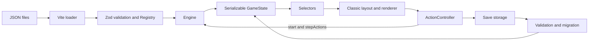

# Text Island: Technical Design Document

Version 0.1 (draft for review) · Companion to `docs/GDD.md` · Last updated: 2026-10-21

Status markers: **[implemented]** describes the current prototype · **[decided]** records design intent · **[proposal]** and **[open]** describe future work. Design examples for knowledge, weather, upgrades, standalone processes and the boat are future extensions; `src/content/schema.ts` is the authoritative supported format.

**Content Studio [implemented, PR-01 to PR-10]:** a localhost-only React Studio in this single package, editing content files and previewing them in the real game. Usage: [STUDIO.md](STUDIO.md); scope and decisions: [implementation plan](CONTENT_STUDIO_IMPLEMENTATION_PLAN.md). See also [testing guidance](TESTING.md).

**Crafting/building trees [implemented]:** separate centre-panel tabs use one shared graph
model and renderer. Personal completion of all prerequisites permanently unlocks nodes;
current resources/tools and discovered local site capabilities still control creation.
Quests remain goals, not creation gates. Version 7 introduced this redesign; the current save version is 8 (`SAVE_VERSION`), and older saves require a fresh game.
Paused creation requires its tools again to resume. A first personal craft of an already-owned
non-repeatable item completes its node but leaves only one inventory copy. See
[the detailed design](CRAFTING_BUILDING_DESIGN.md) for schemas, saved progression, and validation.

---

## 1. Goals and constraints

| # | Requirement | Source |
|---|---|---|
| R1 | All game content (regions, items, activities, buildings, recipes, processes, knowledge, events, weather, stats) is data. Adding a region needs **no engine code changes**. | your brief |
| R2 | Content is authored in JSON and stays canonical; the Studio edits the same files. | [implemented] |
| R3 | Logic inside data uses **structured conditions** (JSON objects), not code or expression strings. | [decided] |
| R4 | Player game remains TypeScript + Vite without UI framework; the Studio is a React page in the same package, served only by the local dev server. | [implemented] |
| R5 | **Action-based clock**: the simulation advances only through player commands. | [decided] |
| R6 | Deterministic and testable: the same seed and commands give the same result. | [implemented] |
| R7 | English inline; translations are not planned for now. | [implemented] |
| R8 | Validator and debug tools remain; the Studio adds form/graph authoring and live preview. Balance simulation is not implemented. | [implemented; simulator future] |
| R9 | Look and feel of *A Dark Room*: text, buttons, log, status panel, occasional illustrations. | [decided] |

### What we keep from *A Dark Room*, and what we change

| *A Dark Room* | Text Island |
|---|---|
| Global singleton modules per location | One engine; regions are data interpreted by generic systems |
| String-path state access through `eval` | Typed `GameState` object, mutated only by systems |
| Scattered `setTimeout` timers | One deterministic `advance(minutes)` step loop |
| Events as JS object literals with callbacks | Events as JSON with a fixed effect vocabulary |
| DOM holds part of the state | UI renders view models; it holds no game state |
| Data-driven scene graph for events | **Kept**, extended with conditions, cooldowns, weights |
| Cooldown buttons, fading log, reveal-by-unlock | **Kept** (bars display persisted work progress) |
| Versioned save migrations | **Kept** |

---

## 2. Architecture



The engine owns simulation and command completion. `ActionController` owns browser scheduling,
step persistence and cancellation when loading or restarting. `dispatch` runs the same work
synchronously in tests. The classic layout supplies fixed panel IDs to the renderer and owns no game state.
Core modules use no DOM, wall clock, or unseeded randomness. The validated registry is read-only
by convention (its outer object is frozen); the runtime state contains plain serializable data.
The JSON loader already acts as an adapter into `buildRegistry`; the Studio validates its
edits with the same function.

---

## 3. Module boundaries [implemented]

| Location | Responsibility |
|---|---|
| `content/**/*.json` | Authored entities, rules and English text |
| `src/content/{loader,schema,registry,text-keys,format}.ts` | JSON adaptation, validation, reference indexing and stable text identity |
| `src/core/engine.ts` | Command checks, live simulation, rewards, events and task completion |
| `src/core/{state,state-schema,work}.ts` | Serializable state, validation and persisted player work |
| `src/core/{action-rules,conditions,timers,production}.ts` | Shared costs/tools, conditions, local timers and production batches |
| `src/core/{clock,rng,text,selectors}.ts` | Time formatting, seeded randomness, narration and UI view models |
| `src/app/action-controller.ts` | Browser scheduler and step persistence callback |
| `src/persistence/{save,migrate}.ts` | Storage boundary, save validation and compatibility |
| `src/ui/` | DOM rendering, panels, fonts, classic layout and scoped styles |
| `src/main.ts`, `src/debug/console.ts` | Application composition and debug commands |
| `tests/`, `e2e/` | Content/unit checks and browser smoke tests |

Runtime dependency: Zod. Build/test tools: TypeScript, Vite, Vitest and Playwright.

### Content files [implemented, Studio PR-02]

Items, recipes, buildings, quests, events, sites and artwork each live in
`content/<kind>/<id>.json` as one object; regions already follow this layout. The registry rejects
arrays and filename/ID mismatches. Singletons remain `game.json`, `stats.json`, `climate.json`
and `trees/{crafting,building}.json`.

**[implemented, Studio PR-03]** Activities live in `content/activities/<id>.json` and areas hold
ordered `activities: ["id"]` links. Registry entries record `{ activity, regions }`; unknown
links and non-global activities without links are rejected. A shared definition retains one
`did`/`today` counter across areas. Globals may also be linked: they appear once at the linked
position there and are appended elsewhere. Registry enumeration follows first area-link encounter
(in region file order), then remaining unlinked activities by ID, preserving existing global order.
Text indexing includes the independent `activities` root; activity memo keys are now
`activities.<id>.<field>`. Explicit text IDs remain unique across every indexed root.

Items, quests, events and buildings accept optional numeric `order`. The registry sorts these
kinds by `(order ?? +Infinity, id)`; the migrated values preserve their prior array order in
increments of ten. Item order breaks ties in automatic provisions and tool enumeration; quest
order controls goal processing and display; event order controls queueing and seeded trigger
checks; building order controls local panel rows. Recipes use tree node order for creation;
sites and artwork are resolved by ID, so these three kinds have no `order` field.

`npm run content:format` rewrites shipped content and frozen fixtures with the shared formatter:
two spaces, inline objects/arrays when they fit 110 columns without multiline children, original
key order, preserved `_` comment keys and one trailing newline. It only changes formatting.

---

## 4. Time and simulation

### 4.1 Clock

- `state.time` is an integer: **minutes since the start** (day 1, 00:00). Day, hour, phase and season are derived in `clock.ts` from `climate.json`.
- The engine advances in fixed steps of `game.stepMinutes` **[implemented: 15 minutes]**. A 3-hour action runs 12 steps; stat rates are per hour, so the step length does not change the balance. The validator rejects action times that are not a whole number of steps. Every system update happens per step, in a fixed order. This keeps results identical no matter how actions are split.

### 4.2 The step order

Implemented provisions: `game.json.provisions` defines the automatic hunger/thirst threshold (60) and shortage note texts. After stat rates and before damage in each clock step, and before post-command quest checks, the engine consumes carried items whose `consume.stats` reduce the relevant need. Strongest relief goes first, repeating until below the threshold or supplies run out. Automatic consumption applies the normal logs, effects, outcomes, and counters without advancing time recursively. Manual consumption suspends automation during its own clock step so one chosen meal is not doubled.

An unmet automatic need sets `auto_hunger_unavailable` / `auto_thirst_unavailable` flags; relief clears them. The drying-rack quest requires the hunger flag and carried raw fish or meat. Shortage notes are queued after successful commands; conditional preparation advice uses `provisions.preparation.when`. `GameState.provisionWarnings` remembers dismissed shortages across saves and rearms after relief; newly available preparation advice can also trigger a note. Raw meat and raw fish have no `consume` definition, so neither manual nor automatic consumption can eat them.

The shared beach drying rack accepts two fish or two portions of meat. Meat drying requires a sharp tool and an idle local rack; its `startCycle` effect selects the named `meat` output on that rack’s production batch. Fish uses the default collection yields. Output identity and consumed inputs are local batch state; no global drying flag is used.

```
for each step (15 minutes):
  1. clock.tick           timers and local building-ready notices
  2. environment.update   body warmth (1 band / hour)
  3. stats.update         per-step rates by effort × modifiers
  4. provisions           automatic food and water before damage
  5. stats.damage         damage rules from stats.json
  6. stats.regen          regeneration rules from stats.json
  7. death check          health ≤ 0 → stop
```

### 4.2b Energy and daily sleep [implemented]

`stats.json` makes energy the first status bar. Working costs its effort rate × elapsed hours. A single ×1.5 multiplier applies when hunger or thirst is at least 41; ×0.5 applies when both are at most 20; otherwise costs are unchanged. There is no hunger, thirst, or exhaustion damage rule. Rest and sleep have zero hourly energy gain. Edible items and direct drinking activities restore energy through their ordinary stat effects.

`game.sleep` defines the bed and shelter buildings, fire timer, wake time (06:00), cutoff (00:00), and six `recovery` entries. Each recovery reason owns its energy value and text: early warm sheltered bed (100), early unheated sheltered bed (80), late warm sheltered bed (80), late unheated sheltered bed (80), exposed bed (50), and ground (50). `sleepRecovery()` selects the reason once at bedtime; the journal and collapse modal use that same entry, even if fire expires overnight. The sleep activity is `global: true`; the engine and selectors can offer shared activities in any region. Its `visibleWhen: { built: "bed", here: true }` restricts voluntary sleep to a bed in the current region; UI visibility, direct command validation, and pre-sleep saves use the same condition. `{ built }` keeps its original global meaning when `here` is omitted. Map icons evaluate conditions at the represented place. Its duration is calculated to the next 06:00, including an early daytime bedtime. Midnight through 05:59 counts as late bedtime. Only the bed, shelter, and fire at the current location count. `{ sheltered: true }` checks either a local built shelter or the region’s `shelterWhen` condition; the discovered beach rocks provide natural shelter. Bed construction requires this condition, without a first-night gate. `shelterWhen` cannot itself contain `sheltered` (including nested conditions), preventing recursion. Sleeping simulates timers, production, needs, and health rules quietly, then sets morning energy and logs the new day and sleep summary. Cold remains a health hazard during sleep.

Non-sleep simulation stops at zero energy or the midnight cutoff and invokes the same overnight routine at the current location. `advance` returns false on death or interrupted work; `Result.interrupted` distinguishes collapse from `Result.died`. Callers stop before applying success rewards, travel, discoveries, or counters. Paused work retains reserved inputs after a surviving collapse; interrupted collection leaves its production cycle available. After-action random events are skipped for interrupted work. A surviving collapse queues a priority note from `game.sleep.collapse`, explaining the missed bedtime and location alongside the new-day and sleep summary; it opens before task-completion notes. Voluntary sleep retains the manual pre-sleep save; every completed command, including collapse, autosaves the resulting state.

### 4.3 Paced actions

`content/game.json` → `cosmetic.msPerHour` is the shared rate, default 10000 ms per game hour.
`Engine.start` reserves inputs and creates a persistent player-owned work record. `stepActions`
advances the live state one 15-minute step; rewards, arrival, discoveries and notes are applied
once at completion. `Engine.dispatch` drains the same steps synchronously for simulations.
`app/action-controller.ts` owns browser scheduling and persists every committed step. The UI
only renders work/progress. Reload resumes the saved work without accounting for offline time.
Sleep advances the clock instantly to 06:00, pausing all player work while building production
continues. Leaving an area pauses its work; materials stay reserved until resumed. Progress stays on each action’s own button; clicking that button pauses or resumes its work. The current UI still offers one active
player action at a time; the core scheduler supports equal focus sharing, with focus allocation
isolated for future perks. Effort rates are weighted by each concurrent action's focus share.
The test-speed URL multiplier changes wall-clock scheduling only.

---

## 5. Game state

The current `GameState` type is inferred from `src/core/state-schema.ts`; do not maintain a
second handwritten interface. State version 8 contains permanent craft/build progression, gameplay and narrative RNG streams,
time/location, stats/warmth, items, counters, flags, regions, typed pop-ups and task state,
local timers, local building batches, player work records, journal and permanent death state.

Building keys are `building@region`; production batches retain their unit count, inputs, output
identity and start time. Player actions retain location, reserved inputs and completed minutes.
The model contains no callbacks or precomputed future state. Storage and migration validate it
at loading boundaries; the engine receives normalized state. Items form the shared carried
stockpile; only content-defined item caps apply. Clothing uses the best owned item per slot.

---

## 6. Content model

### 6.1 Conventions

- **IDs:** lowercase `snake_case`, **unique across all content kinds** (an item and a building can't share an id). This lets conditions refer to things without a type prefix and makes validator messages unambiguous.
- **Text:** written inline in English. Every text field has a stable key (§10).
- **Comments:** JSON has none. Any key starting with `_` (for example `"_note"`) is allowed everywhere and ignored by the loader.
- **Amounts:** `{ "item_id": count }`.
- **Durations:** `hours` (decimals allowed: `0.5`).
- **Effort:** every action declares `effort`: `heavy`, `work`, `light` or `rest`. Stat drain per hour comes from `stats.json`, so authors never compute hunger or energy by hand. An optional `energy` adds an extra fixed cost.

### 6.2 Entity overview

| Kind | Lives in | Purpose |
|---|---|---|
| `game` | `game.json` | start region, start time, start items and stats, constants, sleep, tools, journal lines |
| `stat` | `stats.json` | stat definitions, word bands, rates, multipliers, damage and regen rules |
| `climate` | `climate.json` | day phases, body bands |
| `item` | `items/<id>.json` | materials, food, tools, clothing, containers |
| `recipe` | `recipes/<id>.json` | crafting (node in `trees/crafting.json`) |
| `building` | `buildings/<id>.json` | construction and local production (node in `trees/building.json`) |
| `tree` | `trees/{crafting,building}.json` | creation graphs |
| `site` | `sites/<id>.json` | local site capabilities |
| `region` | `regions/<id>.json` | region metadata, activity ID links, exploration and landmarks |
| `activity` | `activities/<id>.json` | independent actions linked by regions, or global |
| `quest` | `quests/<id>.json` | goals |
| `event` | `events/<id>.json` | scenes and choices |
| `artwork` | `artwork/<id>.json` | illustration metadata |

Future kinds (no schema yet): `knowledge`, `weather`/`season`, `ending`.

**[implemented, Studio PR-03]** Regions own descriptions, unlock rules, view/arrival lines and
landmarks. Activities, items, recipes, buildings and events have independent definitions.

### 6.3 Conditions **[decided: structured; implemented vocabulary below]**

Implemented leaves (`Condition` in `src/content/schema.ts` is authoritative; `range` = optional `gte`/`lte`):

```ts
type Condition =
  | { all: Condition[] } | { any: Condition[] } | { not: Condition }
  | { item: ItemId; gte?; lte? } | { seen: ItemId }          // carried amount / ever owned
  | { flag: FlagId } | { timer: TimerId; gte?; lte? }
  | { at: RegionId } | { region: RegionId }                  // here now / unlocked
  | { stat: StatId; gte?; lte? } | { warmth: BandId[] }
  | { phase: PhaseId[] } | { effort: Effort[] } | { day: { gte?; lte? } }
  | { did: Key; gte?; lte? } | { today: Key; gte?; lte? }    // lifetime / since last sleep
  | { reached: { day; hour? } } | { quest: QuestId; is: "active" | "done" }
  | { discovered: LandmarkId } | { explored: RegionId; gte?; lte? }
  | { tool: ToolTag } | { site: SiteId }                     // tool capability / local site capability
  | { built: BuildingId; here?: boolean } | { sheltered: boolean }
  | { building: BuildingId; is: "idle" | "working" | "ready" };
```

Future leaves from the original design (not implemented): `knowledge`, `season`, `weather`,
`event` (seen), `process`, building `level`/`count`.

Example: "wearing warm clothes and not in a blizzard":

```json
{ "all": [ { "item": "warm_clothes" }, { "not": { "weather": ["blizzard"] } } ] }
```

The evaluator also has `explain(condition)`. It returns the first unmet leaf as a short phrase for tooltips ("needs: spear", "only in daylight"). Each leaf type has one phrase template in the strings file.

### 6.4 Effects **[implemented vocabulary below]**

```ts
type Effect =
  | { give: Amounts } | { take: Amounts }
  | { stat: Partial<Record<StatId, number>> }              // deltas
  | { timer: TimerId; addHours: number }
  | { flag: FlagId } | { unflag: FlagId }
  | { log: Text } | { roll: Outcome[] }                    // nested weighted choice
  | { startQuest: QuestId } | { unlock: RegionId }
  | { build: BuildingId }                                  // add one here, no build step
  | { startCycle: BuildingId; production?: ProductionId; units?: number };
```

Future effects from the original design (not implemented): `learn`, `count`, `discover`,
`explore`, `wait`, `image`, `event`, `checkpoint`, `end`.

Effects are executed in `src/core/engine.ts`. **Adding a new effect type is the main reason to touch engine code** (§14).

### 6.5 Yields and weighted outcomes

```ts
type Yield   = { item: ItemId; min: number; max: number; chance?: number; when?: Condition };
type Outcome = { weight: number; when?: Condition; text?: Text; effects?: Effect[] };
```

Yields roll independently (like *A Dark Room* loot). Outcomes pick one entry by weight among those whose `when` is true.

### 6.6 Region file [illustrative future extensions; legacy embedded activities]

The example below predates PR-03 activity extraction. Current region files use activity ID links;
activity objects live in `activities/<id>.json`. Other future fields remain illustrative.

```json
{
  "id": "forest",
  "name": "the forest",
  "title": "A Quiet Forest",
  "description": ["Tall trunks, close together.", "The sea is only a sound now."],
  "climate": { "baseC": 20, "daySwing": true },
  "travelHours": 1,
  "unlockWhen": { "discovered": "trail_into_trees" },
  "firstVisit": { "log": "The trees close in behind you.", "image": "forest_first" },

  "explore": {
    "name": "look around", "hours": 2, "effort": "work",
    "requires": { "any": [ { "phase": ["dawn", "day", "dusk"] }, { "item": "torch" } ] },
    "nothingLog": ["The trees all look the same now. Nothing new."],
    "discoveries": [
      { "id": "game_trail", "at": 2, "text": ["Hoof prints in the mud. A trail used often."] },
      { "id": "tall_pines", "at": 4, "text": ["A stand of pines, straight as masts."] },
      { "id": "running_water", "at": 6, "text": ["Somewhere ahead, the sound of running water."],
        "effects": [ { "startQuest": "follow_the_water" } ] }
    ]
  },

  "activities": [
    {
      "id": "gather_firewood", "name": "gather firewood",
      "hours": 1, "effort": "work",
      "yields": [ { "item": "firewood", "min": 4, "max": 6 } ],
      "eventChance": 0.05,
      "log": ["Dry branches snap underfoot.", "An armful of deadwood."]
    },
    {
      "id": "hunt", "name": "hunt",
      "hours": 3, "effort": "heavy",
      "visibleWhen": { "discovered": "game_trail" },
      "requires": { "all": [ { "item": "spear" }, { "not": { "phase": ["night"] } } ] },
      "outcomes": [
        { "weight": 5, "text": "The spear finds its mark.",
          "effects": [ { "give": { "raw_meat": 3, "hide": 1 } } ] },
        { "weight": 4, "text": "Nothing. The forest went quiet when you arrived." },
        { "weight": 1, "text": "A tusk catches your leg.",
          "effects": [ { "stat": { "health": -15 } } ] }
      ],
      "eventChance": 0.15, "eventTags": ["hunt"]
    },
    {
      "id": "fell_tree", "name": "fell a tree",
      "hours": 4, "effort": "heavy",
      "requires": { "any": [ { "item": "stone_axe" }, { "item": "iron_axe" } ] },
      "yields": [
        { "item": "log", "min": 1, "max": 1, "when": { "not": { "item": "iron_axe" } } },
        { "item": "log", "min": 2, "max": 3, "when": { "item": "iron_axe" } }
      ]
    }
  ],

  "buildings": [
    {
      "id": "charcoal_clamp", "name": "charcoal clamp",
      "description": "A mound of wood under turf, smouldering for a day.",
      "visibleWhen": { "seen": "clay" },
      "max": 3,
      "levels": [
        { "cost": { "firewood": 20, "clay": 5 }, "hours": 4, "effort": "heavy",
          "log": "You pile the wood and seal it with turf and clay." }
      ]
    }
  ],

  "processes": [
    {
      "id": "burn_charcoal", "name": "burn charcoal", "building": "charcoal_clamp",
      "inputs": { "firewood": 15 }, "hours": 24,
      "outputs": [ { "item": "charcoal", "min": 5, "max": 7 } ],
      "startLog": "Smoke leaks from the mound.",
      "doneLog": "The clamp has burned down. Charcoal, black and light."
    }
  ],

  "events": [
    {
      "id": "wild_boar", "title": "A Wild Boar",
      "trigger": "activity", "tags": ["hunt", "explore"],
      "weight": 3, "cooldownHours": 48,
      "image": "boar",
      "scenes": {
        "start": {
          "text": ["The undergrowth bursts open.", "A boar, head low, tusks yellow."],
          "choices": [
            { "id": "fight", "text": "Stand with the spear",
              "requires": { "item": "spear" },
              "next": [ { "weight": 6, "scene": "won" }, { "weight": 4, "scene": "gored" } ] },
            { "id": "climb", "text": "Climb a tree", "next": "climbed" }
          ]
        },
        "won":     { "text": ["It goes still."], "effects": [ { "give": { "raw_meat": 6, "hide": 2 } } ],
                     "choices": [ { "id": "leave", "text": "Carry it home", "next": "end" } ] },
        "gored":   { "text": ["The tusk opens your thigh. It runs."], "effects": [ { "stat": { "health": -25 } } ],
                     "choices": [ { "id": "leave", "text": "Limp away", "next": "end" } ] },
        "climbed": { "text": ["It circles for an hour, then loses interest."], "effects": [ { "wait": 1 } ],
                     "choices": [ { "id": "leave", "text": "Climb down", "next": "end" } ] }
      }
    }
  ]
}
```

### 6.7 Activity schema

| Field | Type | Meaning |
|---|---|---|
| `id`, `name` | string | |
| `hours`, `effort`, `energy?` | number, enum, number | Time and stat cost |
| `visibleWhen?` | Condition | Button exists only when true (hidden content) |
| `requires?` | Condition | Button enabled only when true; `explain()` gives the tooltip reason |
| `cost?` | Amounts | Consumed items |
| `yields?` / `outcomes?` / `effects?` | see §6.5 | Results |
| `limit?` | `{ total?, perDay? }` | Finite activities (wreck search: `total: 6`) |
| `sequence?` | Outcome[] | Scripted results in order, one per use (wreck finds) |
| `eventChance?`, `eventTags?` | number, string[] | Event roll after the action |
| `log?` | Text or Text[] | One line picked at random |

**Region exploration** (`explore`) is the region's "look around" button **[implemented]**: `{ name, title?, view: [{ text, when? }], nothingLeft?, landmarks: [Landmark] }`. The `explore` command takes no time and opens a pop-up (`events.active.id = "explore:<region>"`): its text is every `view` line whose `when` holds (plus `nothingLeft` when no landmark is left), its choices the landmarks not explored yet whose `visibleWhen` holds, with their time, and *close*. A landmark is `{ id, label, hours, effort, visibleWhen?, requires?, requiresText?, text, effects? }`; choosing it advances time, marks the discovery (`{ "discovered": id }`; `{ "explored": region, "gte": n }` counts them), logs `text` to the journal, applies `effects`, and shows `text` with *close*. Closing that page runs "after explore" event triggers (keys `"explore"` and the landmark id). The button has `badge: "*"` while any landmark is offered. Tests: `lookAround(e)` in `tests/helpers.ts` explores the next landmark in content order.

### 6.8 Buildings **[implemented]**

`content/buildings/<id>.json`: one building object per file. A building is put up in a place and produces over time in **cycles the player starts** (no idle income).

```json
{
  "id": "fish_trap", "name": "fish trap", "icon": "fish", "hint": "…",
  "build": { "hours": 1, "effort": "work", "requires": { "site": "fishable_water" }, "cost": { "willow_twigs": 20 }, "log": "…" },
  "cycle": {
    "start": { "id": "set_trap", "label": "set", "hours": 0.25, "effort": "light", "log": "…" },
    "hours": 2, "batches": 3, "repeat": true,
    "collect": { "id": "empty_trap", "label": "empty", "hours": 0.25, "effort": "light", "yields": [{ "item": "raw_fish", "min": 1, "max": 1 }] },
    "words": { "idle": "not set", "working": "set", "ready": "{n} fish" },
    "readyLog": "Something thrashes in the trap."
  }
}
```

- **Where:** `build.requires` uses `{ "site": capabilityId }` and other current requirements. `content/sites/<id>.json` defines capabilities; region and landmark `siteCapabilities` grant them locally, with landmark grants available only after discovery. The state key remains `"<id>@<region>"` with `{ count, builtAt, batches, nextBatch }`. Tree completion unlocks the building globally; capabilities determine whether the current area permits it.
- **Building it:** the `build` step (`requires`, `cost`, `hours`, `effort`, `log`, `effects`) runs from its tree node where you are. `max` (default 1) is how many can stand in one place (fish trap, corn field: 3); state `{ count, builtAt, batches, nextBatch }`. Input-free units (unbaited traps) join an existing input-free production batch immediately. Required-input units stay empty until supplied; each new planting keeps its own full clock. Starting scales cost/time by empty units; collecting scales by ready units. A quest identifies its building goal through `completeWhen`; costs appear on the tree node, not the task list. The `{ "build": id }` effect adds one where you are without the step (events); `{ "startCycle": id, "units": 1 }` starts production on up to one empty unit here (the newly dug corn field is sown immediately). Omit `units` to start all empty units. An optional `production` selects a named output in `cycle.products`. The `building` command (`step: "start" | "collect"`) is the button in the buildings panel.
- **Cycles:** `start` locks materials in a player action; completion creates a local production batch with `{ id, units, startedAt, inputs, production? }`. Every `hours` one output is ready per unit, up to `cycle.batches` (default 1); readiness derives from game time without browser scheduling. Production advances while away or asleep, never while the game is closed. `collect` locks ready batch IDs, unit counts and output counts when work starts; completion applies `collect.yields` (or the batch’s named `cycle.products` yields) and `outcomes` per claimed output/unit, plus `effects`. Unready batches and units added after collection began remain; collected units become empty, or with `repeat` start again from collection completion. Drying meat selects `production: "meat"` on the local rack rather than setting a global flag. `readyLog` is written when the first batch is ready while you are there (not while asleep). Step ids count like activity ids (`did`, `today`, event `after`); building ids too (when built).
- **Effects on the rules:** `warmthC` adds to the felt temperature in its place (the shelter, +3). Conditions include `{ "built": id }` (any place), `{ "built": id, "here": true }` (current place), `{ "sheltered": true }` (local built or natural shelter), and `{ "building": id, "is": "idle" | "working" | "ready" }`. Bed health regeneration is local; morning energy comes from `game.sleep.recovery`, not hourly multipliers.
- **Local timers:** `local: true` on a timer stores one value per region (`fire@beach`, `fire@forest`, etc.). Effects, conditions, warmth, cooking, and status resolve the current region; all regions’ timers advance, with warnings only for the current area. A building’s optional `timer` supplies its displayed state (campfire: out/burning/roaring). `initializeTimers` ensures the configured timer slots exist; pre-version-8 saves are rejected at the loading boundary. Timer `building` and building `timer` references are validated.
- **View:** `view.buildings` lists, for the current place, the buildings standing here (`label` with ×count; `word`: `word` or the cycle's words, working with the time to the next batch, e.g. "growing · 2d 23h"; the step's button with the scaled time and cost). Panel `#buildingsBox` / `#buildings` in the classic layout (hidden when empty). Built buildings with an `icon` show in the map's hover icons. The task note says "{building} built." (`game.tasks.built`).
- **Validator:** site capabilities, tree membership, conditions, costs, yields, effects and step hours (whole clock steps) are checked; `{ "building": id, "is": … }` and `startCycle` need a building with a cycle.

The 10 buildings in `content/buildings/`:

| Building | Place | Task starts when | Build | Cycle |
|---|---|---|---|---|
| campfire | beach, forest, meadows | beach rocks discovered, or either other area reached | 2 stones, 15m | none; build unlit, light and stoke locally |
| shelter | forest, meadows | task after first night outside shelter; construction requires the bed node | 4 logs, 2h | none; +3 °C, allows a bed |
| bed | any sheltered area | built or natural shelter available | 2 logs, 4 firewood, 1h | none; enables sleep, +1 health/h while sleeping |
| drying rack | beach | automatic eating fails with raw fish or meat carried | 2 logs | hang 2 raw fish or dry 2 raw meat → 12h → dried food |
| rain barrel | sheltered beach | built shelter, or natural shelter after the first night | 3 logs | set out → 12h → drink (thirst −45), repeats |
| fish trap | beach shallows or the river | you found fishing water | 20 willow twigs | set → 1 fish / 2h, up to 3, stays set |
| snares | forest | you found the small trails (day 2+) | 1 rope, 2 firewood | set → 12h → maybe a rabbit (raw meat), repeats |
| corn field | meadows | you found the flat ground | needs a hoe, 2 corn (sown at once) | sow 2 corn → 3 days → 6–10 corn |
| bee hive | meadows | you found the humming (after the bushes) | 2 logs | lure with 2 berries → 3 days → 1–2 honey (smoke: 1 firewood), repeats |
| fish weir | the river | you emptied the trap twice | 6 stones, 2 logs | close → 12h → 2–4 fish, repeats |

Materials and tools: logs (`timber`) require an axe for chopping in the forest. Craft the rock knife to unlock the axe and rope; the axe unlocks the hoe. Stones are gathered under the discovered low cliff. Willow twigs come from the discovered river. Rope (`cordage`) uses four bark strips; stripping bark requires something sharp. These material/tool chains are independent of quest status; quests describe goals rather than opening recipes.

The original design (levels, modifiers) is kept below for later.

**Modifiers** are the only way buildings and items change the rules. The engine sums them:

| Modifier | Effect |
|---|---|
| `localHeatC` | Added to environment °C while the player is in that region |
| `insulationC` (items, by `slot`) | Added to felt °C; best item per slot counts |
| `sleep` | Energy and health recovery per hour of sleep in that region |
| `storage` | Capacity for capped items (e.g. `{ "fresh_water": 4 }` per clay jar) |
| `travelFactor` | Multiplies travel hours to that region (paths) |
| `yieldFactor: { activity, factor }` | Multiplies yields of an activity (mine shaft) |
| `hoursFactor: { activity, factor }` | Multiplies action time (better tools) |
| `statRate: { stat: factor }` | Multiplies a stat's drain rate (shade, hat) |

### 6.9 Items, recipes, processes, knowledge [future design examples]

```json
[
  { "id": "coconut", "name": "coconut", "plural": "coconuts", "category": "food",
    "consume": { "verb": "crack a coconut", "hours": 0.5, "stats": { "hunger": -10, "thirst": -20 } } },
  { "id": "fresh_water", "name": "fresh water", "category": "water", "capped": true,
    "consume": { "verb": "drink", "hours": 0.25, "stats": { "thirst": -35 } } },
  { "id": "clay_jar", "name": "clay jar", "category": "container",
    "modifiers": { "storage": { "fresh_water": 4 } } },
  { "id": "warm_clothes", "name": "warm clothes", "category": "clothing", "slot": "body",
    "modifiers": { "insulationC": 12 } }
]
```

```json
{ "id": "craft_spear", "makes": { "spear": 1 }, "station": "camp",
  "cost": { "driftwood": 2, "sharp_stone": 1, "cordage": 1 }, "hours": 1, "effort": "light",
  "log": "A straight shaft, a lashed point. It will do." }
```

- **Thoughts and today's memories [implemented]:** an activity can list `thoughts`: groups `{ intro?, max?, lines: [{ text, when? }], otherwise? }`, logged before the activity, worked out before it changes anything. Each group logs up to `max` lines whose `when` holds (in order), with `intro` first, or `otherwise` if none holds. The state keeps `today`: counts of what was done (the same keys as `did`), found, walked to and finished since the last sleep; `{ "today": id, gte?, lte? }` tests it, and an activity with effort `sleep` clears it. `afterwards` (same shape) is logged after the activity, from the state it left. While an activity with effort `sleep` advances time the engine logs nothing (damage, timer warnings) except death; the sleep activity's `afterwards` sums up the night instead: when you wake, the worst body state first, the fire. The sleep activity uses one group for tiredness (`{ "stat": "energy", "lte": 20 }`…) and one for up to three memories of the day.
- **Text variants [implemented]:** every journal text is `Text` = a passage or a list of variant passages (lists no longer mean "lines in order": descriptions, discoveries and the intro are single passages). `chooseText` (src/core/text.ts) picks one with the seeded rng, never the variant shown last for that text (`state.lastText`, keyed by the first variant), so saves replay identically. Engine-written lines live in `game.json` → `journal` (`walkTo`, `wayOpens`, `nothingNew`; `{place}` is filled in). Variant mode `"first"` always picks the first variant: unit tests use it via `tests/setup.ts`, the browser test via `?variants=first`; `tests/variants.test.ts` checks the variety itself.
- **Route map [implemented]:** the places panel (`#tabs`) draws a grid map. A region's optional `map: { x, y }` (grid cells, y down) places it; without one, regions line up by `order`. The camp is the region with `travelHours` 0; each other region gets a path from it, labelled with its `travelHours` (travel goes through the camp, so this matches the walking times). Known regions are buttons (click = travel); locked ones are "?" at the end of a dashed path, once their optional `hintWhen` holds (default: from the start; a region whose `hintWhen` is false is not on the map and takes no space in the grid, e.g. the meadows until the low cliff is found). Cells are all the same size (`--map-cell`, `--map-row`); the view (`.map-view`) is as wide as its panel and the grid (`.map`, kept between renders) hangs from its middle, shifted by the current cell (`--hc`, `--hr`), so the place you are in is centred and walking slides the map (a CSS transition; the view's height is symmetric around the current row). The fog is a mask on the view (`--fog-x` × `--fog-y`): clear up to 1.6 cells from the centre, transparent from 2.6; nodes 3+ cells away get `.far` (no pointer events, not focusable). On phones the horizontal fog is the outer 16% of the view. Map icons: an activity's optional `icon` (enum `Icon` in schema.ts, drawings in `src/ui/icons.ts`); `tabs[].icons` lists, per place, the icons of activities whose `visibleWhen` holds (each once, in enum order); hovering or focusing a node shows them in `#mapTip`, which sits outside the masked view. A region new on the map gets the class `new` (a short pulse) once no pop-up covers the map, until the next non-choose command (`UI.pulse`). View model: `tabs` (nodes with `col`, `row`, `hours` from here) and `map` (`cols`, `rows`, `paths`, `unknown`).

**A new place [implemented]:** regions unlocked during a command (by `unlockWhen` or an `unlock` effect) are offered in the pop-up that opened them (`Engine.offerNewPlaces`): a look-around finding gets `game.newPlace.text` ({place}) as an extra paragraph (`active.hint`, not written to the journal) and a `go:<region>` button per place (`active.go`, label `newPlace.go`, with the walking time) before *close*; a task note from the same command gets the buttons (its text already says the way opens); otherwise a note titled `newPlace.title` with the text and the buttons. `go:<region>` closes the pop-up and travels there (after-explore events then follow).
- **Modal vs journal prose [implemented]:** for event scenes, `text` is the full modal narrative and optional `journal: Text` is a short entry (legacy fallback: `text`). For exploration landmarks, `text` is the full discovery modal and optional `journal: Text` is its brief journal record; `explore.view[].text` is modal-only. A region's first-visit `description` and `firstVisit.log`, repeat `arrive[].text`, and activity/recipe/item/building logs go directly to the narrow journal. Long shortage preparation advice is shown in the note, but the journal only writes the shortage itself. New content should follow `docs/NARRATIVE_STYLE.md` and include a summary for each substantial modal.
- **Arrival view [implemented]:** a region can list `arrive` lines, `{ "text": Text, "when"?: Condition }`. On every arrival after the first (which logs `description` and `firstVisit.log`), the engine logs each line whose `when` holds, in order, so the view reflects time of day, discoveries and timers, e.g. `{ "text": "Smoke rises from the ring of rocks.", "when": { "all": [ { "discovered": "rock_shelter" }, { "timer": "fire" } ] } }`. The validator checks the conditions.
- **Item actions [implemented]:** an item can list `actions` — controls labelled with the action's `label`, grouped by building or carried item, e.g. raw fish → `{ "id": "cook", "building": "campfire", "label": "cook", "hours": 0.5, "visibleWhen": { "timer": "fire" }, "effects": [ { "give": { "cooked_fish": 1 } } ] }`. Each use spends one of the item (`uses`, default 1; `0` keeps it, e.g. the water can's *fill*) plus any `cost`; the `itemAction` command runs it. An optional validated `building` id on an item action places it under that local building, with the item name in its label (e.g. “cook raw fish”). Actions without a building, such as filling the water can, appear under the carried item in the consumables section. All items with `consume` or `actions` are listed in consumables, even when their controls are unavailable at the current location. Other possessions are listed in inventory with counts only. An item can have `max` (e.g. 4 drinks of `can_water`): getting more stops there. Eating (`consume`) is a button of the same kind.
- **Future station proposal:** stations such as a workbench, forge or loom could add local creation requirements; no station field is implemented.
- Processes (§6.6) belong to a building. Several processes per building are allowed (the kiln fires pots *or* bricks).
- Knowledge: `{ "id": "boiling_water", "name": "boiling water", "learnWhen": { "item": "clay_pot" }, "log": "Water boiled in clay will not make you sick." }`. It can also be granted by the `learn` effect.

### 6.10 Events

**[implemented, simpler than the design below]** `content/events/<id>.json` holds one event object: `{ id, title, trigger, when?, repeat?: { cooldownHours }, scenes }`. Triggers: `"start"` (a new game opens it before the first journal line; `game.start.log` is written when it ends), `{ "at": { day, hour } }`, `{ "when": Condition }` (both checked after each action), `{ "after"?: [activity id | tag | item id | "explore" | "travel"], "chance" }` (a seeded roll after a matching action). An event happens once unless it has `repeat`. Scenes: `{ text, effects?, choices?, close? }`; the event opens on `start`. A choice: `{ id, label, visibleWhen?, requires?, requiresText?, effects?, next? }` (no `next` ends the event); a scene without choices shows one button, `close` (default label "close"), that ends it. While an event is open the engine refuses every command except `{ type: "choose", choice }`. A scene may provide a compact `journal: Text` alongside its full modal `text: Text`: the journal records the summary before choice effects; legacy scenes without `journal` fall back to logging `text` (for the shipwreck: the storm, the swim, then `game.start.log`). Ordinary event choices take no game time and return no progress bar; landmark and travel choices use the shared timed-command rate. New effect `{ "unlock": regionId }`. The design below (weights per scene, phase/sleep triggers, priorities, images) is not built yet.

| Field | Meaning |
|---|---|
| `trigger` | `activity`, `explore`, `arrive`, `phase` (with `phases`), `sleep`, `condition`, `manual` |
| `tags?` | For `activity`: match `eventTags` of the action (empty = any action in scope) |
| `regions?` | Scope; events inside a region file default to that region; global events omit it |
| `when?` | Condition |
| `weight`, `cooldownHours?`, `once?` | Weighted pick, minimum hours between repeats, one-time |
| `chance?` | For `phase` and `sleep` triggers: probability per occurrence |
| `priority?` | `condition` events with priority interrupt immediately (story beats) |
| `image?` | Illustration on the start scene |
| `scenes` | `start` is required. Scene: `text[]`, `image?`, `effects?` (on enter), `choices[]` |
| choice | `id`, `text`, `requires?` (shown disabled with reason), `visibleWhen?`, `cost?`, `effects?`, `next`: scene id, `"end"`, or weighted list `[{ weight, when?, scene }]` |

While an event is active, every command except `choose` is rejected. An event stack is not needed. Queued events wait in `events.queue` and open after the current one closes.

### 6.10b Quests **[decided]**

**Better sleep [implemented]:** the task starts once `survive_first_night` is done. Completion requires `{ sheltered: true }`, `{ built: "bed", here: true }`, and `{ timer: "fire" }` together at the current location. Separate areas cannot contribute partial facilities.

**Task notes [implemented]:** when a quest completes, the engine queues a note (`state.events.notes`) that opens as a pop-up when the command is over (it blocks the game like an event; `close` ends it). Title `game.tasks.title` ({task}); text: the quest's `doneLog` (already in the journal, not logged again) and what changed since the command began: items gained (`tasks.gained`, {item} {where}) and used (`tasks.used`), places opened (`tasks.opened`), buildings built (`tasks.built`), and, when crafting or building finished it, actions now possible here (`tasks.possible`). Tests: `startGame` closes notes automatically unless `{ keepNotes: true }`.

Example of an additional task (not shipped):

```json
{
  "id": "light_a_fire",
  "title": "light a fire",
  "trigger": { "when": { "all": [ { "reached": { "day": 1, "hour": 16 } }, { "not": { "did": "light_fire" } } ] } },
  "completeWhen": { "timer": "fire" },
  "startLog": "The sun is low. It will be cold soon.",
  "doneLog": "Warmth, and a little light against the dark.",
  "effects": []
}
```

- Files: `content/quests/<id>.json`, each one object. The tasks panel lists active quests in registry order (`order`, then ID).
- Tasks are goals, not recipes **[implemented]**: no task asks you to craft a tool; requirements belong to the activity, item action or craft/build step that fulfills the goal. Quest `hint`, `needs`, and `build` fields were removed because the title-only task panel does not use them. The task panel displays titles only; requirements and costs appear on creation-tree nodes. Tasks have no buttons and never unlock creation; things are made in the crafting and building tabs (below). The quest finishes through its normal `completeWhen` (e.g. `{ "seen": "raw_fish" }`, `{ "built": "shelter" }`).

**Tool tags [implemented]:** requirements name a use, not an item. `game.json` → `tools` defines the tags (`sharp`, `fire_starter`) with a `label` (shown next to items that have it: *knife · sharp*) and `needs` (what `explain` says: "needs something sharp"). An item has `tool: { tags, amount?, hoursFactor? }`: knife `sharp`; rock knife `sharp`, ×2; matches `fire_starter`; stones and firewood `fire_starter` with `amount: 2`. The condition `{ "tool": tag }` holds when you have `amount` of any item with the tag. An action whose `visibleWhen` / `requires` ask for a tool (not under `not`) takes the quickest such item's `hoursFactor` times as long (`toolFactor`, `Engine.hoursFor`; activities, recipe ways, item actions, landmarks, building steps; the shown times too). When the way differs by item (texts, chance), content uses separate activities or recipe ways with item conditions: the three *light fire* activities (`light_fire` matches, `strike_fire` 2 stones, `make_fire` friction, which requires `{ "tool": "fire_starter" }` and 5 firewood: 3 to burn, 2 sticks), the spear's two ways (rock knife texts when it is the only sharp thing).

**Crafting and building trees [implemented]:** `content/trees/*.json` defines one graph of each
kind, with category branches and nodes referencing recipes or buildings. `after` requires all
parents personally completed; roots have an empty list. Registry validation rejects missing
references, missing nodes, duplicate parents, quest gates, and cycles. Depth derives from the
longest parent path. `technology.craft/build` persist separate `completed` and `unlocked` sets;
found items and granted buildings do not complete nodes, and later dependency edits retain
surviving unlocks. Creation uses direct `{ type: "craft", recipe }` and `{ type: "build", building }`
commands. Recipes retain common `requires`, method `ways`, costs, duration and narrative;
buildings retain their construction and local production definitions. Availability and hints
share requirements with engine checks. A non-repeatable recipe may be personally crafted
once even while its output is owned, consuming normal materials/time and leaving one copy.
The centre's area/crafting/building tabs keep the map, journal, status and shared work summary
available. Switching tabs does not pause work. All nodes stay visible as compact name chips
with state marks and persisted node-specific progress. Crafting and building share the same
placement and connection functions in `ui/tree-layout.ts`; neither kind has separate layout rules.
Nodes are 120 × 40 px. Reserve complete descendant branch widths before placing them. A lone
child is centred on its predecessor; all siblings stay in one horizontal row with the midpoint
of its outermost node centres on their parent. Multi-parent groups centre on the mean of their
predecessor centres and retain every edge. The canvas grows to contain all branches; panel
width does not wrap siblings or alter branch geometry. Connections use vertical stems and
shared horizontal forks without obstacle routing or gutter detours. The bounded tree viewport
scrolls in both directions without causing page overflow. `ui/tree.ts` measures the viewport
independently of the canvas width, centres the root on first display, and preserves both scroll
offsets on state updates. Categories do not own columns or headings: `TreeNodeView.category`
carries the authored branch name into the item's tooltip tag.

Both tree panels hide their native scrollbars while retaining native wheel/trackpad, touch,
and keyboard scrolling. Shared pointer handling adds grab-and-drag panning for mouse/pen.
A movement threshold distinguishes a drag from a node click; only real drags capture the
pointer, hide inspection hints, and suppress pointer click activation. Pointer release,
cancellation, or lost capture ends the gesture. Normal creation/inspection clicks and keyboard
activation keep their existing behavior. Install gesture handlers once per mounted tree.

The layout measures single-parent descendant bounds recursively, packs complete branches,
then recentres sibling node positions on their parent. Shared descendants are grouped by
their complete prerequisite set and placed below existing components, centred on their parents'
mean position, with their own single-parent descendants reserved normally. Every prerequisite
is drawn directly. The current single-parent trees have clear stems and forks; an arbitrary
multi-parent graph can have crossing connectors. The layout does not change dependencies,
drop links, or introduce obstacle routing to hide those crossings.

`ui/tree.ts` keeps controls keyed and owns one floating tooltip outside the scroll viewport.
Hover/focus or a dedicated state/inspection control shows category, prerequisites, current
requirements, duration and progress; clicking the item name still creates/resumes directly.
The inspection control pins and focuses the tooltip so long requirement lists can scroll by
touch, wheel or keyboard. Hover hints do not intercept neighbouring controls; Escape closes
a pinned hint and returns focus to its inspection control.
Hints remain inspectable during work while the existing command lock prevents extra starts.
Tooltips are clamped to the viewport and dismissed on navigation, popups and engine replacement.
Craft/build popups and their menu commands are removed; local building operations remain in the
area panel.
- Item grouping follows capabilities: `consume` or a nonempty `actions` list places an item in consumables; other items go in inventory. Task-gain notes name the same section.
- `trigger`: `"start"`, `"manual"` (only via the `{ "startQuest": id }` effect) or `{ "when": Condition }`.
- New condition leaves: `{ "did": id, "gte"? }` counts finished activities, item uses and **tags** (`"tags": ["drink"]` on an activity or a `consume` block); `{ "reached": { "day", "hour"? } }` compares the clock; `{ "quest": id, "is": "active" | "done" }` chains quests.
- State: `quests: { [id]: { status, startedAt, doneAt? } }` and `counters: { "did:<key>": n }`. Both are part of the saved game, so loading it rolls quests back too.
- The engine runs `syncQuests()` after every command (and at a new game): start triggered quests, finish active ones whose goal is met, apply their effects. It repeats up to 10 passes, because finishing one quest can start another.
- Validator: unknown `did` keys, unknown quest ids, and `"manual"` quests that no effect ever starts are errors. A tag may not share its name with an id.

### 6.11 Climate and stats files (illustrative excerpt; shipped values in `content/climate.json` and `content/stats.json`)

```json
{
  "_note": "phases are hour ranges; an id may repeat to wrap around midnight",
  "phases": [
    { "id": "night", "from": 0, "to": 5, "tempC": -6 },
    { "id": "dawn", "from": 5, "to": 7, "tempC": -3 },
    { "id": "day", "from": 7, "to": 18, "tempC": 0 },
    { "id": "dusk", "from": 18, "to": 20, "tempC": -2 },
    { "id": "night", "from": 20, "to": 24, "tempC": -6 }
  ],
  "seasons": [
    { "id": "spring", "days": 20, "tempC": 0,
      "weather": [ { "id": "clear", "weight": 5 }, { "id": "rain", "weight": 3 }, { "id": "storm", "weight": 1 } ] }
  ],
  "weather": [ { "id": "rain", "name": "rain", "tempC": -3, "rollHours": 6 } ],
  "bodyBands": [
    { "id": "freezing", "belowC": 5 }, { "id": "cold", "belowC": 15 },
    { "id": "comfortable", "belowC": 28 }, { "id": "hot", "belowC": 34 }, { "id": "overheating" }
  ]
}
```

```json
{
  "stats": [
    { "id": "thirst", "start": 40, "words": [
      { "upTo": 25, "word": "quenched" }, { "upTo": 50, "word": "dry" },
      { "upTo": 80, "word": "thirsty" }, { "upTo": 100, "word": "parched" } ] }
  ],
  "ratesPerHour": {
    "heavy": { "hunger": 4, "thirst": 6, "energy": -8 },
    "work":  { "hunger": 3, "thirst": 5, "energy": -5 },
    "light": { "hunger": 2, "thirst": 4, "energy": -2 },
    "rest":  { "hunger": 2, "thirst": 3, "energy": 0 },
    "sleep": { "hunger": 1.5, "thirst": 2, "energy": 0 }
  },
  "multipliers": [ { "when": { "warmth": ["hot"] }, "stat": "thirst", "factor": 1.3 } ],
  "damage": [
    { "when": { "warmth": ["freezing"] }, "healthPerHour": -3 }
  ],
  "regen": [ { "when": { "all": [ { "stat": "hunger", "lte": 50 }, { "stat": "thirst", "lte": 50 }, { "warmth": ["comfortable"] } ] }, "healthPerHour": 1 } ]
}
```

Damage, regeneration and multipliers are themselves conditions. New survival rules are data.

---

## 7. Command pipeline

1. The UI sends a command through `ActionController.send` to `Engine.start`.
2. The engine guards death/open pop-ups, checks requirements, reserves costs, and creates work
   for a timed action. Menus and ordinary choices resolve without advancing time.
3. The controller schedules `stepActions` at `cosmetic.msPerHour` (the retained configuration
   name). Each step advances live simulation and persists the result.
4. Completion removes the work record before applying rewards, arrival or discoveries. Task
   checks, unlocks, notes and eligible events run against the resulting state.
5. The controller renders selector output and schedules the next step when work can continue.

`dispatch` drains this same pipeline synchronously for headless tests. Commands are `activity`,
`travel`, `consume`, `explore`, `craft`, `build`, `itemAction`, `building`, `choose`, `pause`, and `resume`.
Crafting/building nodes send direct creation commands; sleep/rest are activities. Pop-ups pause scheduled work, travel
and sleep pause work requiring presence, and reserved inputs survive those interruptions.

---

## 8. Selectors and view models

`src/core/selectors.ts` defines the current `View` and `ButtonView` types. The view includes
route-map nodes/paths, available controls, grouped building and item actions, status bars,
active task IDs/titles, inventory, journal turns, typed pop-up choices and persisted work
progress. The renderer owns DOM updates and presentation, not gameplay checks or durations.
Costs and disabled reasons appear on action controls and creation nodes; task rows contain titles only.
Tests and headless callers can read the same view. Recipe/building visibility comes from
content `availableWhen` and place conditions; requirements/costs determine enabled state.

---

## 9. Randomness and determinism

- `rng.ts` implements **sfc32**, seeded at new game. The 4-number state is saved in `GameState`.
- Gameplay uses `state.rng`; wording uses the independent `state.narrativeRng`. All random draws use `rng.ts`; core code does not call `Math.random`.
- Because saves contain the RNG state, a reload replays the same rolls for the same choices (anti-save-scum, GDD §6.4).
- A future simulator can run many seeds; current bug reports can include the seed and command log for deterministic reproduction.

---

## 10. Localisation **[not planned]**

English only for now (owner, 2026-10-21). Stable text keys exist (see "Outcome narration and
stable text identity"); any future localization needs its own design decision first.

---

## 11. Persistence

```ts
interface SaveFile {
  saveVersion: number;
  current: GameState;       // autosave after commands/work steps; manual slot on save. and before sleep
  savedAt?: string;         // the saved game only
}
```

- Storage: `localStorage["textisland.save"]` (autosave) and `localStorage["textisland.saved"]` (the saved game). Export/import UI remains future work.
- **[implemented, replaces checkpoints]** Death is permanent: the engine sets `state.death = { time, cause, lines }` (the end screen's lines, chosen once: `game.ending.survived` with `{time}`/`{day}`, and `ending.cause` with `{cause}`). The cause is the damage rule hurting most when health hits 0 (`cause` on `stats.damage`; ties are joined with "and"), else what the command was (an event's title, "bad <food>"), else `ending.defaultCause`. Storage (src/persistence/save.ts): the autosave `textisland.save` after every action and committed work step (a reload continues; a death stays), and the saved game `textisland.saved`, written by *save.* in the menu and just before every sleep (`engine.willSleep(cmd)`); the end screen offers *load the saved game* and *start again*.
- **Save boundary:** version 8 is required in both the envelope and state. `restoreState` validates against `GameStateSchema` and reconciles installed-content references. Earlier saves require a fresh game; unsupported or malformed data is preserved and reported until the player chooses recovery.
- **Content drift:** loading reconciles current registry IDs, clamps content-defined limits and supplies missing stats. Removed work targets return surviving reserved inputs; compatible work keeps progress. There is no content hash dependency.

---

## 12. UI layer


**Pop-ups [implemented]:** events, look around and notes share `#event`. The `close` choice is not a button under the text: `renderEvent` shows it as `#eventBack` ("← back", the choice's label; default "back") in the title line (`.title-row`, right-aligned, the title's height), and hides `#eventChoices` when nothing else is left. In the prologue (the shipwreck) it stays a button under the text (`scene.close`: "wash ashore"). The back arrow, a click on the backdrop (`#event` itself) or Escape sends `close`; not in the prologue.
- **No framework [decided].** `render.ts` keeps keyed control rows and buttons so focus and progress animations survive refreshes. If this grows painful, `lit-html` (a templating library, ~3 kB) is a drop-in fallback **[proposal]**.
- Shared panel skeletons in `src/ui/layouts/panels.ts` supply fixed DOM IDs; `render.ts` fills story, route map, actions, status, tasks, stores and pop-ups.
- **Styles:** CSS custom properties; one selected serif typeface; light and dark themes; centred page up to 1280 px; keyboard focus visible.
- **Book-page foundation [implemented]:** shared surface, ink, outline, spacing, and selection
  tokens in `ui/styles.css` give controls and panels a restrained hierarchy in both themes.
  All typography retains the selected `--font`; classic placement stays in its scoped CSS.
- **Illustration support [implemented]:** optional
  `content/artwork/<id>.json` objects define `{ id, src, width, height, alt }`. `game.json` chooses
  one global `panorama` ID; regions can supply fallback artwork if it is absent. Items and
  buildings reference them with `artwork: id`; the registry validates IDs, nonblank alt text,
  local `illustrations/` paths, positive integer dimensions, and 1600 × 440 region fallback metadata.
  Files belong in `public/illustrations/`; paths in content omit `public/` and a leading slash.
  Selectors resolve metadata for the global panorama, possession/building rows, and tree
  tooltips. Creation nodes retain their compact dimensions.
  `ui/illustration.ts` supplies one keyed image updater using Vite's base URL, explicit image
  dimensions, eager panorama/tooltips and lazy item pictures. Semantically described panoramas
  keep authored alt text; pictures paired with visible item labels are explicitly decorative.
  Missing metadata or a failed load hides only the image slot. Failed sources are remembered
  per slot to avoid repeated requests; stale image events cannot replace a newer image.
  Monochrome ink uses multiply blending in light mode and inverted screen blending in dark
  mode. No artwork enters saves or changes gameplay. The shared panorama is the one selected
  island image, recorded at its actual 2116 × 743 source size and cropped in CSS to a 160:33 slot.
- **Input:** mouse first; keyboard shortcuts for tabs (1–7) and for event choices (1–4) **[proposal]**.

---

### 12b. Classic layout **[implemented]**

The task list displays goal titles only: no material counts, requirement rows, or requirement tooltips. Craft/build tree tooltips show costs and requirement explanations. Quest content contains the goal conditions, logs and effects; obsolete requirement/progress/hint metadata has been removed from content and selectors.

The action area is one shared `panel.actions()` block: untitled local activities (`#actions`, with look around above other activities; creation is in the separate crafting/building tabs), local buildings (`#buildings`), and consumables (`#consumables`). `View.environmentActions`, `buildings[].actions`, and `consumables` own presentation grouping; the existing flat `actions` list remains available for simulations. Optional validated `building` ids on activities and item actions route them to a building standing here. Fire activities and cooking belong to campfire, sleep to bed, and meat drying to drying rack; production keeps its existing building command. Items with `consume` or any `actions` definition go in consumables, including when no portable control is currently available; everything else goes in the read-only inventory, including materials, passive tools, and clothing. The renderer keys building/item rows and their buttons so focus and cooldown bars survive refreshes. Buildings and consumables are hidden when empty, in the classic layout.

Classic is the only supported layout. `src/ui/layouts/classic.ts` provides its skeleton
from fixed-ID panels in `panels.ts`; `classic.css` scopes placement and sizing under
`.layout-classic`. A shared `#areaPanorama` slot sits before the route map, outside every
tabpanel. It renders the same global image on every tab and after travel. The body uses
flexible 1:2:1 columns; below 900px it stacks map, actions, journal, and sidebar. The journal's
`#regionTitle` uses `View.title` and changes on actual arrival, independently of journal text
and selected action tab. `#workBox` remains outside tabpanels so work controls stay available.
The renderer mounts the skeleton once and displays the newest 30 journal lines,
newest first, fading older entries. Alternate layouts, the registry, layout-specific story
modes, and the layout picker have been removed. Old layout URL parameters and localStorage
preferences are ignored; game saves are unaffected. Font choices still use `--font` and their
own menu/storage. Classic's responsive rules stack panels on narrow screens; shared phone
rules provide 44px tap targets and a font-menu sheet. Log entries retain their `turn` and
selectors group them in reading order before flattening the classic journal.

## 13. Tooling

### 13.1 Content validator: `npm run content:check` [implemented]

The command runs `tests/production-content.spec.ts` against shipped `content/`: Zod structure,
registry reference, ID, and content-invariant checks. **[implemented, Studio PR-02]** It also
checks canonical formatting of shipped content and frozen fixtures; use `npm run content:format`
to fix formatting. It rejects legacy arrays and filename/ID mismatches. It does not assert prose or labels.
`registry.ts` explicitly checks
conditions, costs, effects, yields, tool tags, building production outputs and step durations.
General progression reachability, unused-item warnings and translation validation are future
tooling; they are not current guarantees.

### 13.2 JSON Schemas for authoring [future]

Planned generation from the Zod schemas into `schema/`. A `.vscode/settings.json` maps them to `content/**` by glob, so VS Code gives autocomplete, hover docs and red squiggles while you type. The same schemas will drive the future editor.

### 13.3 Debug console [implemented]

`src/debug/console.ts` installs `window.ti` in development or with `?debug`. It can give items,
adjust stats, advance game time, unlock areas, start tasks and inspect state. See the current
commands in `README.md`; a debug overlay is future work.

### 13.4 Balance simulator [future]

- Runs the real engine headless in Node with a scripted player (no UI).
- **Bot policy [proposal]:** (1) survival rules first (drink, eat, sleep at night or when tired, warm up); (2) otherwise follow a target list: the next unmet region unlock, then the next boat stage; a small dependency resolver walks the content (recipes, yields, discoveries) to pick the action that moves toward the target.
- Output: a CSV timeline per seed and a summary table with median and p90 day and estimated real minutes per GDD milestone, deaths with cause, and the hours spent per activity (bottlenecks).
- Estimated real time = clicks × seconds-per-click + event scenes × seconds-per-scene (constants in `game.json`).
- Candid limit: the bot will not play like a human. Use it to catch regressions and gross pacing problems. Final tuning needs real playtests.

### 13.5 Content Studio **[implemented, PR-01 to PR-10]**

Usage: [STUDIO.md](STUDIO.md). Scope and decisions: [CONTENT_STUDIO_IMPLEMENTATION_PLAN.md](CONTENT_STUDIO_IMPLEMENTATION_PLAN.md).

---

## 14. Data versus code

What you can add **without touching engine code**:

| Change | Files |
|---|---|
| New region with activity links and landmarks | new `content/regions/<id>.json` (+ artwork); independent `content/activities/<id>.json` |
| New item, food, tool, clothing | `content/items/<id>.json` |
| New recipe | `content/recipes/<id>.json` + a node in `content/trees/crafting.json` |
| New building with production | `content/buildings/<id>.json` + a node in `content/trees/building.json` |
| New site capability | `content/sites/<id>.json` + `siteCapabilities` on a region or landmark |
| New quest | `content/quests/<id>.json` |
| New event or story beat | `content/events/<id>.json` |
| New day phase, body band, temperature rule | `content/climate.json` |
| New survival rule (damage, regen, multiplier) | `content/stats.json` |
| New artwork | `content/artwork/<id>.json` + file in `public/illustrations/` |

Future content kinds with no schema yet (need code first): knowledge, weather, seasons, endings,
boat stages.

What **needs code**:

| Change | Where |
|---|---|
| A new condition or effect type | `src/content/schema.ts` + `registry.ts` check + `src/core/conditions.ts` / `engine.ts` + test |
| A new modifier type | `src/core/` rule helpers (e.g. `action-rules.ts`) + schema entry |
| A new stat that isn't a 0–100 meter | `src/core/engine.ts`, `state-schema.ts`, selectors |
| A new UI panel or mini-game | `src/ui/` |
| A new trigger type for events | `src/core/engine.ts` + schema entry |

**Workflow to add a region (example: a marsh):**

1. Create `content/regions/marsh.json` with `unlockWhen`, `explore` and activity ID links; define activities in `content/activities/<id>.json`.
2. Hook it into the chain: add a discovery to an existing region (e.g. lake: `{ "id": "reeds_to_the_east", "at": 8 }`) and reference it in `unlockWhen`.
3. Add any new items to `content/items/`.
4. Drop illustrations into `public/illustrations/`.
5. `npm run content:check`, then play with `ti.unlock("marsh")`.

---

## 15. Testing

- **Unit (Vitest):** conditions (each leaf and combinators), effects, clock, stat steps, temperature bands, player work, local production, saves and weighted picks with fixed seeds. They load frozen `tests/fixtures/content/`, independent of shipped prose and labels.
- **Golden traces [implemented, Studio PR-01]:** `tests/golden-traces.test.ts` replays seeded commands on the frozen content and compares normalized state and journal with committed snapshots. See [testing guidance](TESTING.md) for the baseline contract.
- **Content validation:** `npm run content:check` validates shipped data structurally, without matching text. Unit tests exercise validator failures with fixed test data.
- **Browser smoke tests (Playwright):** `npm run test:e2e` builds a separate `dist-test/` using the frozen fixture, then tests core play, saves, pop-ups and the classic layout on desktop and phone widths. The production `dist/` continues to use shipped content. Simulator smoke tests remain future work.
- **Runtime and scope:** isolated browser contexts run on two workers, including cases in the same file. `.env.engine-test` sets real-time action steps and UI animation durations in milliseconds; engine simulations keep their content-defined game-time costs and run synchronously or with fake timers. The paced browser case advances a controlled clock rather than waiting for seconds. [Testing guidance](TESTING.md) assigns coverage to each layer and describes focused development checks.

---

## 16. Milestones **[proposal]**

| # | Deliverable | Done when |
|---|---|---|
| M0 | Repo skeleton, Zod schemas, loader, validator, schema export, VS Code autocomplete | `content:check` passes on a tiny beach file |
| M1 | Core loop: clock, stats, temperature, beach activities, log, status, stores, save/load | You can survive (or die) for 3 days on the beach |
| M2 | Crafting, buildings with levels, processes, travel, region unlocks | Forest and lake playable |
| M3 | Event engine with all triggers, weather, seasons, knowledge | 15 events running |
| M4 | Debug console, simulator v1, checkpoints with RNG | Simulator report for beach → lake |
| M5 | Content pass: all 7 regions, ~60 items, mystery decision applied | Full game reachable per validator |
| M6 | Shipyard stages, voyage event, endings | Simulator completes the game across 50 seeds |
| M7 | Illustrations, polish, dark mode, audio (if decided), playtests, balance | Real playtest completes the game (no fixed playtime cap; GDD §20.7) |
| M8 | Content Studio **[done]** | PR-01–PR-10 in CONTENT_STUDIO_IMPLEMENTATION_PLAN.md; game playable after each merge |

---

## 17. Risks and decisions to revisit

| Risk | Mitigation |
|---|---|
| The condition/effect vocabulary grows too large | Add a new type only when three pieces of content need it; otherwise express it with flags and counters |
| JSON is tiring to write by hand | Content Studio (implemented); `_note` fields for comments |
| Region files become long | The loader also accepts a region split across `regions/<id>/*.json`, merged by id |
| Re-evaluating every condition after each command gets slow | Not expected below a few thousand entities; add indexes only when profiling shows a need |
| Content refactors break saves during development | Any merged PR may require a fresh game (owner, 2026-10-21, confirmed for all PRs 2026-10-23; see ARCHITECTURE.md). Bump save version with clear restart UI when needed; fresh-game save/reload must always remain working. |
| Image generator licensing | Decide before M7 (GDD §14) |

## 18. Open technical questions

1. Process outputs: straight into the stockpile, or collected on visit (GDD §8.4)? This changes the `collect` command.
2. Typeface: classic Times New Roman as in *A Dark Room*, or a webfont (for example a Garamond)?
3. Hosting target: itch.io, GitHub Pages, or your own domain?
4. Should the debug console be available in release builds behind `?debug`, or dev builds only?

### Shared work rules (implemented)

`core/action-rules.ts` owns availability checks, combined item-action input costs, cost scaling,
and tool-adjusted work duration. Duration is rounded up to the next simulation step, identically
for previews and execution. Entity schemas share work fields and the registry shares their
reference checks; JSON remains the authoring format, not an engine dependency.

### Save compatibility boundary (implemented)

`core/state-schema.ts` defines both runtime state types and their structural validator.
`persistence/migrate.ts` is the only compatibility boundary: it rejects pre-redesign saves, repairs
removed references, and preserves surviving progress. The engine accepts normalized state.
Version 8 (current) requires a fresh game for all earlier saves; version 7 was the crafting-tree redesign boundary. Missing areas relocate to the starting area, and missing
pop-ups are dismissed. Unsupported or malformed saves remain on disk and show an explicit
new-game choice. Major prototype changes may require an announced reset; ordinary content
updates preserve compatible progress, including earned technology unlocks after dependency edits. Envelope and inner-state versions must agree; both autosave and manual slots respect the version boundary. Incompatible or malformed manual slots are not offered for loading.

### Outcome narration and stable text identity (implemented)

Introduced in version 3, current saves retain independent gameplay and narrative random streams. Weighted outcomes are
selected and their effects applied before choosing their narrative. Changing wording, adding
variants, or using `?variants=first` cannot change rewards or event rolls. Supported saves retain both RNG streams exactly.

Existing inline strings/variant arrays remain supported. The registry indexes arrays by entity
ID and field path (not English wording or file order). Text can also use an explicit stable ID:
`{ "id": "hunt_success", "variants": ["You caught a rabbit.", "A rabbit hangs from your belt."] }`.
Explicit text IDs must be unique and survive moving text between content entities. These keys
keep text identity across edits (variant memory, explicit IDs); no translation is planned. Outcome text belongs to its outcome, rather than a generic random
pool that might describe a different result.

### Typed pop-ups (implemented)

The version-7 state stores a discriminated `Popup` union: event (event ID and scene),
exploration (area and optional discovered landmark), or note (title and text).
Old encoded IDs and creation menu popups are not accepted across the fresh-game boundary. Selectors provide display IDs,
numeric work durations, and explicit progress targets to the renderer; labels never decide
whether a choice advances time. Supported pop-ups restore without replaying scene effects.

### Persistent work records (implemented)

The work model introduced in version 5 records owner, location, work identity, required/completed minutes, reserved
inputs, and running/paused status. Completion refers to content IDs rather than callbacks or
precomputed future snapshots. On loading, a job whose referenced content was removed is dropped
and its surviving inputs returned; compatible jobs retain progress. Real-time callbacks are
invalidated on restart/load. Nothing advances while the game is closed. Crop-specific batches,
bait choices, a skill tree and a multitasking UI remain subsequent gameplay work.

### Local production records (implemented)

The production model introduced in version 6 stores independent production batches under each `building@region`. Batch inputs
record the materials already consumed; distinct input/output groups can retain separate clocks,
leaving empty units available for later planting. Production helpers in `src/core/production.ts`
own unit allocation and readiness. Legacy timestamp/flag conversions were removed at the version-7 fresh-game boundary. Pending collections preserve their
original locked output/unit counts. Loading reconciles claims against surviving batches and
content limits. Bait selection and crop-specific planting controls remain future gameplay work.

---

## 19. Content Studio [implemented, PR-01 to PR-10]

Architecture, decisions, gates and PR order live only in
[CONTENT_STUDIO_IMPLEMENTATION_PLAN.md](CONTENT_STUDIO_IMPLEMENTATION_PLAN.md); usage in [STUDIO.md](STUDIO.md).

## Content Studio foundation — [implemented, PR-04]

`studio/index.html` and `src/studio/` provide a React read-only content browser. The serve-only
file plugin is `tools/vite-content-api.ts`; its request/response contract and current limitations
are documented in [STUDIO.md](STUDIO.md). `ContentError` retains its string problems and adds
structured diagnostics; `src/content/index.ts` is a re-export-only public surface.

ESLint boundaries run during typecheck, and production build tests inspect the emitted module
graph and files for Studio dependencies. The game entry, engine, persistence, content and frozen
fixtures remain unchanged by this foundation. Later editor features remain scoped by the
[implementation plan](CONTENT_STUDIO_IMPLEMENTATION_PLAN.md).

**[implemented, PR-04.1]** Registry validation records raw-file positions at the problem source;
legacy strings are derived from those structured entries. Studio browser tests use a temporary
copy of the frozen pack through `STUDIO_ROOT` (see [Studio usage](STUDIO.md)). Registry ID ordering
uses code-unit comparison. Older-save recovery uses neutral wording without a version bump.
